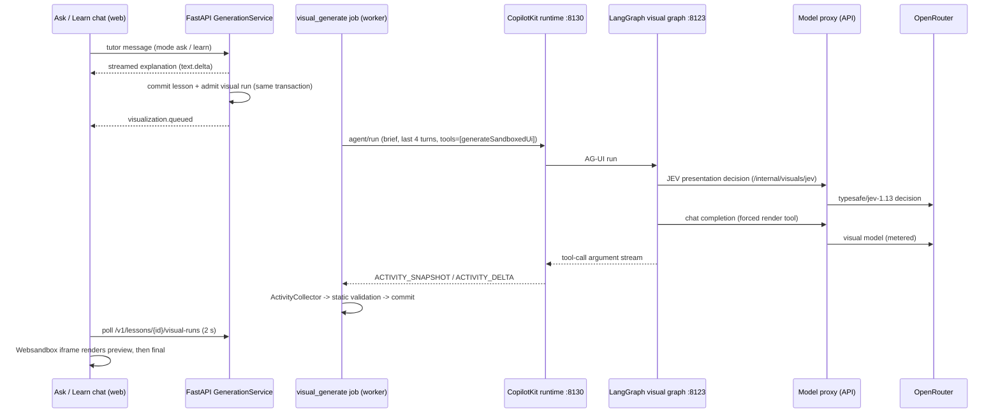
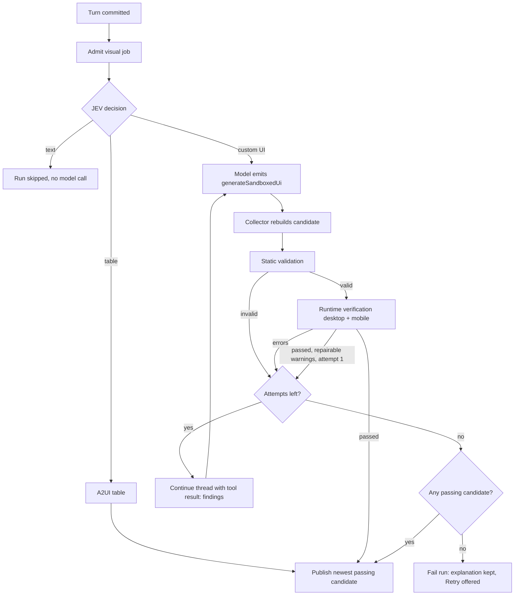

# Generative UI engine: audit, architecture and decisions

Prepared 12 October 2026 on branch `claude/generative-ui-engine` (based on `main` at `52b53f6`). This document covers the existing-architecture audit (Deliverable 1), the improvement proposal (Deliverable 2) and the resulting technical architecture (Deliverable 3). Measured results are in [GENERATIVE_UI_EVALUATION.md](GENERATIVE_UI_EVALUATION.md).

Everything below was established by reading the code at the cited paths and by running the pipeline locally. Statements about behavior that were only inferred are marked as such.

## 1. Audit of the existing architecture

### 1.1 How a visual is produced today



| Concern | Where | Behavior |
| --- | --- | --- |
| When to generate | `backend/app/generation_service.py:728-866` | With `OPENLEARN_VISUAL_ENGINE=openintelligentui`, **every** tutor turn admits a durable `visual_generate` job after the explanation commits. The graph's JEV middleware (`integrations/openintelligentui/upstream/apps/agent/src/visualization_router.py`) then chooses `text`, `a2ui` (table) or `open_generative_ui` (custom UI) from the last four turns. The legacy regex cue planner (`visualization_planner.py`) is used only when the engine is off. |
| Request representation | `visual_runs.py:admit`, `visual_context.py`, `openintelligentui.py:generate` | A bounded brief: question (≤4000 chars), title, ≤2 source excerpts, committed explanation (≤2000 chars), ≤4 recent turns, ≤2 prior visuals described as **readable text only** (exact table data kept; executable code is deliberately excluded). Total brief ≤12 KB. |
| Model and prompts | `integrations/openintelligentui/agent.py` | Deep Agents graph, `create_deep_agent` with upstream `SYSTEM_PROMPT`, the vendored design skill, three skill documents (master-playbook, svg-diagrams, advanced-visualization) and an Open Learn addendum. Model: `OPENLEARN_VISUAL_MODEL` (locally `nvidia/nemotron-3-ultra-550b-a55b:free`). `max_tokens=8192` in both the agent (`agent.py:71`) and the proxy (`openintelligentui.py:544`), although the usage policy allows 16000 and the model 65536. |
| Representation | `visual_tools.py` | Executable code: the `generateSandboxedUi` tool takes `css`, `html`, `jsFunctions`, `jsExpressions` streamed in that order. Tables use A2UI (`render_a2ui`, catalog `copilotkit://open-generative-ui-tables`). There is no other structured path for new visuals. |
| Validation | `visual_code.py`, `openintelligentui.py:ActivityCollector.final` | `node --check` syntax parse, literal-JSON normalization, exact class-to-id repair, regex rejection of `fetch`/`XMLHttpRequest`/`WebSocket` and placeholder text. **No runtime execution.** |
| Repair | `agent.py:VisualToolsOnly.awrap_tool_call` | Intended to return validation errors to the model for up to three render calls. **It never runs** (see 1.3, finding A). |
| Execution and isolation | `web/components/generated-visual/upstream/renderer.tsx`, `frame-content.ts`, `@jetbrains/websandbox` | `srcdoc` iframe with `sandbox="allow-scripts"` only (opaque origin, no cookies/storage/parent DOM), CSP meta: `default-src 'none'`, scripts only inline plus `/visual-assets/`, `connect-src 'none'`, images limited to USGS tiles and Wikimedia. Libraries (Three, OrbitControls, D3, Chart.js, GSAP, Leaflet) are bundled locally by `web/scripts/build-visual-assets.mjs`; no CDN. |
| Host bridge | `generated-visual.tsx` | Whitelisted functions only: `getState`, `saveControl` (validated numeric control), `focusVisual`, `visualError`, `sendPrompt` and `openLink` (both require an explicit learner click in the host). |
| Streaming to UI | `visual_runs.py:run_visual_job`, `visual-runs.tsx` | The collector stores the latest snapshot on the run record at most every 2 s; the browser polls every 2 s and renders a CSS-first progressive preview, then the final sandbox. |
| State | `visual_runs.py:change`, `generation_routes.py` PATCH | Numeric `<input type=range|number>` controls are extracted from HTML (≤8). Trusted changes persist as owner-scoped, revision-checked deltas (≤500 revisions); voice can change them. Other state (selections, toggles, animation) is local to the iframe. |
| Failure handling | `visual_runs.py`, `visual-runs.tsx` | Explanation is never blocked. Failed runs show a scoped message and **Retry visual** (new accounted attempt). Crash after a provider result commits the saved candidate without re-billing. Cancellation stops graph work. |
| Persistence | `practice_records` kinds `visual_run`, `generated_visual`, `visual_revision` | Immutable first revision plus control deltas; lesson blocks hold `generated_ui_ref` references; journeys updated in the same transaction. Payload ≤512 KB. |
| Ask and Learn | `learn-chat.tsx`, `compact-tutor-chat.tsx`, `lesson-reader.tsx` | Both modes share `GenerationService` and render visuals through `LessonReader` → `LessonVisualRuns` / `Visualization`. One integration point. |
| Metering | `openintelligentui.py` proxies, `usage/transport.py` | Every model and router call is reserved before dispatch and settled from the provider receipt. Visual model input ≤48,000 serialized bytes. |
| Infrastructure | `integrations/openintelligentui/Dockerfile`, `serve.py` | One container: API + private graph (Python) + runtime (Node). Playwright Chromium is already installed in the image and the backend venv. |

### 1.2 Strengths worth keeping

1. **The isolation boundary is sound.** An opaque-origin `allow-scripts` iframe, a strict CSP with `connect-src 'none'`, locally bundled libraries and a minimal validated bridge is the right shape. Generated code never runs in the host's privileged context, and prompt instructions are not the only control.
2. **Durable, owned, metered jobs.** Leases with fencing, idempotent admission, crash recovery without double billing, cancellation and per-call metering are production-grade, and the explanation is never held hostage by the visual.
3. **Progressive streaming.** CSS-first previews morph in as HTML streams, which gives early visible content for long generations.
4. **One code path for all custom visuals,** with A2UI for exact tables. Ask and Learn share it.
5. **Persisted numeric state with voice control** and portable HTML export.

### 1.3 Findings: defects, bottlenecks and gaps

| # | Finding | Evidence | Impact |
| --- | --- | --- | --- |
| A | **The repair loop never executes.** `generateSandboxedUi` is a CopilotKit *frontend* tool; `CopilotKitMiddleware.after_model` intercepts frontend tool calls so the run ends and the client can execute them. `VisualToolsOnly.awrap_tool_call` is therefore never called for it. | `copilotkit/copilotkit_lg_middleware.py` (`after_model` intercept); no "Visual validation failed" line in any historical log; baseline runs show exactly one model call before `visual_invalid_javascript`. | Every syntactically invalid candidate fails the whole run on its first attempt. |
| B | **No runtime verification.** Only parsing is checked. | `visual_code.py`. | Runtime exceptions, blank canvases, NaN readouts, clipped layouts and dead controls reach learners; the card's generic "could not initialize" notice is the only signal, and it never reaches the server. |
| C | **Windows-only crash in validation.** `node --check` was fed source with the platform encoding (cp1252), so any visual containing Γ, θ, →, ✓ or emoji raised `UnicodeEncodeError`, failing the job. | Reproduced; fixed first so the baseline is meaningful (`visual_code.py`, regression test). | Local development lost most scientific visuals. Linux (UTF-8) deployments were unaffected. |
| D | **Complexity ceiling.** 8,192 output tokens, a 180 s generation deadline and a 240 s ticket lifetime. | `agent.py:71`, `openintelligentui.py:394,544,105`. | Multi-part simulations and dashboards are truncated or time out; a repaired second attempt could not fit in the deadline. |
| E | **Conversational edits regenerate from a description.** Prior visuals reach the model only as readable text (`visual_context.readable_html`), by design. Each follow-up creates an unrelated new artifact; there is no lineage. | `visual_context.py`, `visual_runs.commit`. | "Now show the field lines" loses the working simulation and its behavior, and costs a full regeneration. |
| F | **A model call is spent when no visual is needed.** When JEV chooses `text`, the graph still invokes the visual model with all tools removed and discards the prose. | Usage ledger: ~5.8K-input-token visual model call on a `text` decision; `visualization_router.routed_request`. | Latency, rate-limit consumption and cost on every non-visual turn. |
| G | **Runtime errors are invisible to operators.** The frame's `visualError` bridge sent no message. | `frame-content.ts` `MEASUREMENT_JS`. | No way to diagnose failures that happen in the browser. |
| H | **The artifact limit conflicts with retries.** The collector rejected a third distinct activity (`visual_artifact_limit`), so a retry-based design could not publish. | `openintelligentui.py:276,315`. | Blocks any repair loop. |
| I | **Model input is near its cap.** The forced render request is ~33 KB of the 48 KB cap before any prior code. | Proxy log `input_bytes=33352`. | No room for repair context or edit source. |
| J | **The configured visual model cannot produce forced tool calls.** On OpenRouter's free endpoint, `nvidia/nemotron-3-ultra-550b-a55b:free` returns empty arguments for a named `tool_choice`, prose for `required`, and in the pipeline every string argument (`css`, `jsFunctions`) was cut at exactly 1,024 characters. With `tool_choice: auto` the same model wrote 4,086 characters. `nemotron-3-super-120b-a12b:free` (30 KB) and `cohere/north-mini-code:free` (12–32 KB) produce full forced arguments. | Direct provider probes; captured provider requests show our schema has no length limits; collector events show 1,024-character arguments. | The dominant cause of baseline failures: every artifact was truncated JavaScript. |
| K | **Static DOM check rejects valid code.** Any `getElementById('x')` without a static `id="x"` failed the run, including elements the script itself creates. | Reproduced with a three-line example; 4 of 11 baseline failures. | Correct dynamic visuals were discarded. |
| L | **Prompt and runtime disagree on imports.** The upstream skill teaches `three/examples/jsm/controls/OrbitControls.js`, but the import map only defined `three/addons/...`; the bundled `three` and `d3` modules had no default export, so the common `(await import('three')).default` idiom failed. | Live runs: `Failed to resolve module specifier`, `Cannot read properties of undefined (reading 'Scene')`. | 3D and D3 visuals failed for reasons unrelated to model quality. |
| M | **The free allowance covers about three visuals per window.** Each visual-model call holds ~32M micro-credits of the 100M `free-v1` grant (5-hour window) even for a free model, and each JEV call 12.5M. | Usage ledger during the first baseline. | Learners on the free plan exhaust visuals after a few turns (a policy decision, not changed here). |
| N | **Progressive preview depends on the provider streaming tool arguments.** Nemotron Super delivers all arguments at the end (first argument byte at 60 s of 60 s); Cohere streams from ~6 s. | Direct streaming probes. | With non-streaming providers the preview appears only when generation finishes. |

### 1.4 Security review of the existing boundary

- No privileged execution: generated code runs only in the opaque sandbox; the host evaluates nothing from the model.
- The bridge accepts only typed arguments; `sendPrompt` and `openLink` require a learner click; `saveControl` is bounded and revision-checked server-side.
- Sidecars never hold provider keys; tickets are HMAC-signed, short-lived and bound to an owner and a live job lease; both sidecars listen on loopback only.
- Residual risks (unchanged by this work): `'unsafe-eval'` is required by Websandbox; images may load from two reviewed hosts; a malicious candidate can still burn CPU in its own frame (browsers throttle offscreen cross-origin frames, and the frame is destroyed on unmount).
- New surface introduced by this work: server-side headless rendering of untrusted candidates. Controls are listed in section 3.4.

## 2. Improvement proposal

Essential changes are implemented on this branch; optional ones are listed with the reason they were not built.

| # | Problem | Current implementation | Proposed change | Reasoning | Expected impact | Trade-offs | Priority |
| --- | --- | --- | --- | --- | --- | --- | --- |
| 1 | Broken visuals reach learners (B) | Syntax check only | **Headless runtime verification** that mounts the candidate with the chat card's own frame, program and Websandbox, at desktop (720 px) and mobile (360 px), and checks: uncaught errors, console errors, script timeouts, empty or flat renders, blank canvases, collapsed or frame-clipped drawing surfaces, NaN/undefined/Infinity readouts (also with every numeric control at its minimum and maximum), clipped overflow, oversize height, unlabeled controls, text drawn over other text, low text contrast in the dark theme, and whether each control changes visible output | Objective defects are detectable cheaply; Playwright and Chromium already ship in the venv and image | Defective candidates never publish; specific diagnostics drive repair | ~3–8 s per candidate; a new server-side execution surface (mitigated in 3.4) | Essential |
| 2 | No repair (A, H) | Dead agent-side wrapper | **Repair through the AG-UI protocol**: after each run, verify; if it fails, continue the same thread with a `tool` result carrying the diagnostics (how CopilotKit clients return frontend tool results). Publish the newest passing candidate. Bounded attempts (default 3) and one optional polish pass for user-visible warnings | Uses the protocol as designed; no change to upstream graph semantics | First-attempt failures become recoverable | Extra model calls only on failure; longer worst case | Essential |
| 3 | Complexity ceiling (D, I) | 8,192 tokens / 180 s / 240 s ticket / 48 KB input | Configurable output limit (default 16,000, the usage-policy maximum), deadline (default 600 s) with matching ticket lifetime, and a visual-specific input bound (default 160 KB) still reserved conservatively | Larger artifacts need room; repair and edit context need input space | Complex simulations fit | Higher worst-case reservation for paid models (still bounded by allowance policy) | Essential |
| 4 | Edits regenerate (E) | Text description of prior visual | **Source-based editing with lineage**: when the newest turn targets a prior generated visual, the model receives that visual's exact source and must return the complete revised artifact; the result is a new artifact with `lineage` (root, parent, version) and carries over values of controls that still exist. The parent stays untouched, so failures leave the previous version working | Preserves working behavior and state; append-only history avoids cross-lesson mutation conflicts | Edits keep the simulation and add the requested change | Prior source enlarges input; the parent remains visible in its original turn (by design) | Essential |
| 5 | Wasted call on text decisions (F) | Model invoked, output discarded | End the graph before any model call when JEV selects `text` | No product value is lost | One fewer model call per non-visual turn | None | Essential |
| 6 | Invisible browser failures (G) | Message-less bridge | `visualError` carries a bounded kind/message; verification summary persisted with each artifact | Diagnosability | Operators and the UI can explain failures | None | Essential |
| 7 | Generation quality | Upstream design skill | Add explicit quality contract to the prompt: responsive sizing, wired controls, units/formula display, numerical guards, and the fact that the artifact is machine-tested at 360 px and 720 px | Models follow testable, concrete rules | Fewer repairs | Slightly larger prompt | Important |
| 9 | Visual model incompatible with forced tool calls (J) | `OPENLEARN_VISUAL_MODEL=nvidia/nemotron-3-ultra-550b-a55b:free` | **Configuration recommendation:** use a model verified to emit full forced tool arguments (`nvidia/nemotron-3-super-120b-a12b:free` was used for the evaluation; `cohere/north-mini-code:free` also qualifies). Verify any candidate with `work`-style probes or the benchmark before switching | Measured: the configured model cannot produce artifacts longer than 1,024 characters per field | Largest single quality gain | Free models are rate-limited and vary; a reviewed paid model needs a tariff entry (`OPENLEARN_VISUAL_MODEL_TARIFFS`) | Essential (configuration, not code) |
| 10 | False-positive DOM rejection (K) | Hard failure | Recognize ids the script assigns; with runtime verification available, defer unresolved lookups to the real browser; keep the strict rule only when verification is unavailable | Runtime observation is authoritative | Valid dynamic visuals publish | None | Essential |
| 11 | Import mismatch (L) | Prompt teaches an unmapped path | Map `three/examples/jsm/controls/OrbitControls.js`; give `three`, `d3` and OrbitControls bundles namespace default exports; add targeted repair hints for module and null-reference errors | Remove failures that have nothing to do with model quality | 3D/D3 visuals work with either idiom | None | Essential |
| 12 | Dark mode and resource cost unmeasured | Light theme only | Verifier adds a dark-theme pass with a text-contrast check (repairable warning) and samples main-thread busy fraction and JS heap after settling | Theme consistency and runtime cost are requirements | Hardcoded colors are caught; animation cost is visible | +2–3 s per verification | Important |
| 13 | Displayed physics can be wrong while every check passes | Benchmark-only formula checks | **Science checks in the pipeline** for priority topics (gradient descent, projectile, Ohm's law, neuron activation, pendulum, transmission-line reflection); `science_mismatch` is an error | A visual with wrong physics is worse than none | Validated on 44 stored artifacts: 2 genuine defects found, 0 false positives after fixes | Only measurable visuals are checked (18 of 44 unmeasured) | Essential |
| 14 | Drawing correctness invisible to DOM checks | Human review only | **Optional screenshot judge** whose problems feed the polish attempt; never a gate | Paid judges caught 4/4 badly drawn visuals with accurate reasons | Specific repair feedback for drawing errors | ≈$0.0005 and ~3 s per first attempt; stricter than a human | Important |
| 15 | Metering over-charges visual calls | Lost receipts kept the full reservation; rejected requests kept it too | Drain finished generations for their receipt; settle rejections at zero | Allowances and platform budgets reflect real cost | ~10× over-statement removed | Bounded 30 s background drain | Essential |
| 16 | Paid Claude models unusable | Forced tool choice and routing flag | Configurable routing flag and `auto` tool-choice mode | Enables Haiku/Sonnet 5.5 | Haiku works; Sonnet ready but unbenchmarked (budget) | Claude repair continuations still return HTTP 400 (open) | Important |
| 8 | Repair visibility in UI | "Preparing an interactive visual…" | Run progress (attempt, verifying, repairing, findings count), lineage label ("Version 2 of …"), fullscreen inspection | Long generations need truthful progress | Learners understand waits | Minor UI work | Important |
| — | Structured spec path for common charts (Path A expansion) | Legacy `VisualizationSpec` renderers exist but are off; A2UI tables are live | **Not built.** Measured simple-chart generation already succeeds through the code path once repair and verification exist; a second renderer family would duplicate validation, persistence and editing logic | Cohesion over a second system | — | Revisit if benchmarks show the code path is unreliable or slow for a specific chart family | Rejected for now |
| — | React/TSX generation, Sandpack or WebContainers | Plain HTML/CSS/JS with an import map | **Rejected.** No build step is needed; Sandpack's bundler and WebContainers add startup latency, memory (poor on mobile) and remote dependencies. Models write vanilla DOM, SVG, Canvas and Three.js reliably, and streaming previews depend on the current four-channel contract | Simplicity, mobile performance | — | Multi-file component apps are not a goal for in-chat visuals | Rejected |
| — | Cloud sandboxes (E2B, Cloudflare) for visuals | Browser execution | **Rejected for rendering.** Visuals run client-side. Server-side verification uses the existing local Chromium. Daytona remains available for agent tasks | Cost, latency | — | Python-backed simulations would need it; none of the benchmark tasks did | Rejected |
| — | Multimodal screenshot judging as a publication gate | — | **Rejected.** Free judges were unusable; paid judges (row 14) are accurate but stricter than a human reviewer (they rejected 8 of 9), so they inform repair instead of blocking | — | — | — | Rejected as a gate |
| — | Diff/patch edit tool (`old_str`/`new_str`) | — | **Deferred.** Would cut edit latency for small changes, but requires a backend tool path outside CopilotKit's activity streaming. Full revised artifacts from exact source were sufficient in measurement | Scope | — | Large artifacts re-emit all code on edit | Optional |
| — | Additional libraries (KaTeX, physics engines) | Six bundled modules | **Not added.** No benchmark task failed for lack of a library; KaTeX needs a font CSP change | Avoid speculative dependencies | — | Equations render as text | Optional |
| — | Redis, object storage for artifacts | Workflow store, 512 KB cap | **Not needed** at current artifact sizes | Avoid infrastructure | — | Revisit above ~200 KB median artifacts | Rejected |

## 3. Technical architecture

The detailed contracts below describe the implemented system.

### 3.1 Components and responsibilities

| Component | Location | Responsibility |
| --- | --- | --- |
| Presentation decision | upstream `JevVisualizationMiddleware` (unchanged) + `EndOnTextDecision` in `agent.py` | Choose text / table / custom UI; end without a model call for text |
| Edit targeting | `visual_context.py` | Identify the newest generated visual in the conversation; supply its exact source and control state when the newest turn asks to change it |
| Visual producer | Deep Agents graph in `agent.py` | Generate the artifact through `generateSandboxedUi` / A2UI with design and quality guidance |
| Orchestrator and repair loop | `openintelligentui.py:generate` | Drive AG-UI runs, collect activities, verify every candidate, continue the thread with diagnostics, choose the publishable candidate, enforce deadlines |
| Science checks | `visual_science.py` | Route priority topics from the request and test displayed values against governing formulas inside the rendered visual |
| Screenshot judge (optional) | `visual_judge.py` | Review a verified first attempt's screenshot with a reviewed multimodal model; problems become a repairable warning |
| Static validation | `visual_code.py` | Parse JavaScript, normalize literal JSON, repair exact DOM-id mismatches, reject network APIs |
| Runtime verification | `visual_verification.py` + `web/components/generated-visual/verification-kit.ts` | Mount the candidate exactly as the card does in headless Chromium; report objective findings |
| Persistence and lineage | `visual_runs.py` | Commit artifacts, revisions, lineage and carried-over state; expose run progress |
| Renderer | `web/components/generated-visual/*` | Sandboxed iframe, bridge, progress, lineage label, fullscreen |

### 3.2 Data flow with verification and repair



### 3.3 Contracts

**Generated visual (persisted spec, additive fields):**

```json
{
  "version": 2, "type": "generated_ui", "id": "visual_…", "revision": 1,
  "renderer": "open_generative_ui", "title": "…",
  "content": {"css": "…", "html": ["…"], "jsFunctions": "…", "jsExpressions": ["…"], "htmlComplete": true, "generating": false},
  "controls": [{"id": "gravity", "label": "Gravity (m/s²)", "minimum": 1, "maximum": 25, "initial": 9.8}],
  "controlValues": {"gravity": 3.7},
  "verification": {"status": "passed", "digest": "…", "durationMs": 4100, "findings": [{"severity": "warning", "code": "unlabeled_control"}]},
  "lineage": {"rootId": "visual_…", "parentId": "visual_…", "parentRevision": 3, "version": 2}
}
```

`verification` and `lineage` are optional, so historical records remain valid.

**Run progress (on `visual_run`, read by `GET /v1/lessons/{id}/visual-runs`):** `progress: {"attempt": 2, "maxAttempts": 3, "stage": "generating" | "verifying" | "repairing", "findings": ["runtime_exception"]}`. Whether a run edited a prior visual is visible on the published artifact's `lineage`; the run record does not predict it, because the model decides whether the request is an edit.

**Edit target (in the run brief):** `editTarget: {id, title, revision, lineage, controls, controlValues, source: {css, html, jsFunctions, jsExpressions, initialHeight}}`, present only when an earlier turn's generated visual exists, its source is at most 64,000 characters, and the question reads as a change (`visual_context.EDIT_CUE`). The producer declares a revision with the optional `generateSandboxedUi` argument `editOf`; only the offered target id is honored, and commit re-checks that the parent belongs to the same owner and conversation.

**Verification report (internal):** `{status: passed|failed|unavailable, findings: [{severity: error|warning|info, code, message}], viewports: {desktop, mobile}, digest, durationMs}`. Only `summary()` (status, codes, digest, duration) is persisted: no page text, screenshots or code.

**Repair message (AG-UI):** the orchestrator replays the run's messages plus the assistant tool call it observed and appends `{"role": "tool", "toolCallId": …, "content": "Runtime verification failed …\n- [error] runtime_exception: …"}`.

### 3.4 Execution and sandbox boundaries

| Boundary | Control |
| --- | --- |
| Learner browser | Unchanged: opaque `allow-scripts` iframe, CSP, local libraries, validated bridge |
| Server verification browser | Separate Chromium process tree with its OS sandbox enabled by default (`OPENLEARN_VISUAL_VERIFY_CHROMIUM_SANDBOX`), fresh context per pass, service workers blocked, every request aborted except the kit and reviewed modules served from disk, frame CSP still applied, no cookies/credentials/API access, 15 s mount deadline, 45 s overall, concurrency ≤ `OPENLEARN_VISUAL_VERIFY_CONCURRENCY` (default 2) |
| Degradation | If assets, Playwright or the browser are unavailable, or the verifier faults, the report is `unavailable` and publication falls back to static validation (logged); a candidate is never failed because of a verifier fault |
| Sidecars | Unchanged: loopback only, HMAC tickets bound to owner, job and lease, no provider credentials |

### 3.5 Configuration

| Variable | Default | Purpose |
| --- | --- | --- |
| `OPENLEARN_VISUAL_MAX_OUTPUT_TOKENS` | 16000 (max 16000) | Visual model output limit (agent and proxy) |
| `OPENLEARN_VISUAL_DEADLINE_SECONDS` | 600 (60–1200) | Whole generation including repairs; ticket lifetime follows |
| `OPENLEARN_VISUAL_MAX_INPUT_BYTES` | 160000 (max 256000) | Serialized input bound for the visual model profile |
| `OPENLEARN_VISUAL_MAX_ATTEMPTS` | 3 (1–4) | Generation attempts per run |
| `OPENLEARN_VISUAL_POLISH_WARNINGS` | `on` | One extra attempt for user-visible warnings after a passing first attempt |
| `OPENLEARN_VISUAL_RUNTIME_VERIFICATION` | `on` | Disable runtime verification (static only) |
| `OPENLEARN_VISUAL_JUDGE_MODEL` | unset (off) | Screenshot judge model; requires an entry in `OPENLEARN_VISUAL_MODEL_TARIFFS` |
| `OPENLEARN_VISUAL_TOOL_CHOICE` | `named` | `auto` for models that refuse forced tool calls (Claude Sonnet/Opus 5.5 with mandatory reasoning) |
| `OPENLEARN_VISUAL_REQUIRE_PROVIDER_PARAMETERS` | `true` | `false` for Anthropic models, which OpenRouter's routing flag otherwise excludes |
| `OPENLEARN_VISUAL_ASSET_DIR`, `OPENLEARN_VISUAL_VERIFICATION_KIT` | `web/public/visual-assets`, `web/.visual-verification/verification-kit.js` | Built by `web/scripts/build-visual-assets.mjs` |

### 3.6 Deployment

`integrations/openintelligentui/Dockerfile` gains a Node build stage that builds the reviewed library modules and the verification kit from `web/` and copies them into the image, with the two path variables set. Chromium was already installed there. Without the assets the service still starts and reports runtime verification as unavailable in `/v1/visual-pipeline/capability`.

### 3.7 Testing strategy

- Unit and integration tests for the verifier against real Chromium (`backend/tests/test_visual_verification.py`, fixture artifacts in `backend/tests/fixtures/visuals/cases.json`).
- Orchestrator tests with a scripted runtime stream: repair continuation, newest-passing selection, polish fallback, attempt limits, deadline, edit lineage and state carry-over (`backend/tests/test_openintelligentui.py`, `test_visual_runs.py`).
- Frontend tests for the shared program, lineage label and progress (`web/tests/generated-visual*.test.tsx`).
- Live benchmark against the real pipeline (`backend/scripts/visual_benchmark.py`), reported in [GENERATIVE_UI_EVALUATION.md](GENERATIVE_UI_EVALUATION.md).
