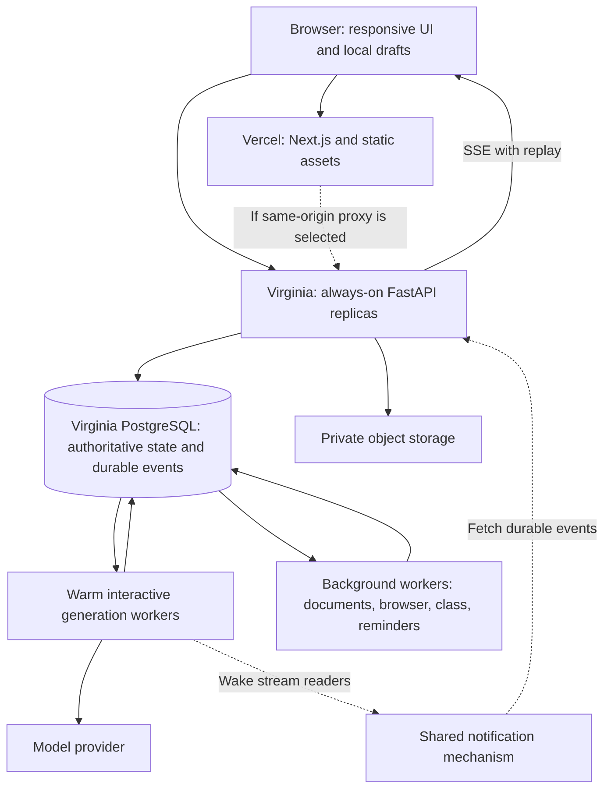

# Open Learn: scalable architecture review

Date: 2026-10-10. Decision proposal only; no application, infrastructure, or billing changes made.

Follow-up: [P01 inventory](performance/Deployment_Inventory.md) records the subsequent live settings check, including dashboard auto-deploy/group drift. [P01–P04 evidence](performance/P01_P04_Implementation_and_Validation.md) records implemented code and outstanding hosted activation. This original review describes the pre-implementation architecture.

## Recommendation

Keep Next.js on Vercel, FastAPI on Render, and Supabase PostgreSQL/auth/object storage. Move API and execution services close to the existing Virginia database, use always-on capacity, and separate interactive requests from background execution. Keep one modular backend codebase with independently deployable process roles. Optimize database round trips and the response path before considering a platform migration.

This is the best fit supported by current evidence, not a guarantee that a particular vendor will always provide low latency. Sustained performance requires capacity limits, measurements, overload handling, and release discipline. A full remote AI answer in fractions of a millisecond is not feasible.

## What was verified

| Layer | Observed configuration | Consequence |
| --- | --- | --- |
| Frontend | Vercel production functions in iad1; deployment ready | Frontend server work is in US East |
| API | Render openlearn-api, Oregon, Free, 0.1 CPU / 512 MB; current deployed commit matches local HEAD f53b96f | Limited shared capacity; API/database traffic crosses regions |
| Database | Supabase Open Learn, North Virginia us-east-1, t4g.nano, Free organization | Keep compute near this data before adding more remote calls |
| Database snapshot | CPU 4%, RAM 58%, 16/60 connections | Does not establish database CPU exhaustion; application pools can exhaust independently |
| Organization quotas | Egress 6.60/5 GB, storage 1.34/1 GB, log ingestion 1.11/1 GB; dashboard warns restrictions from Oct 27 if still over quota | Resolve production capacity/quota policy; these totals cover the organization, not necessarily only Open Learn |
| Runtime | Free deployment runs embedded workers; api-free runs migrations before starting the API | Background work and startup work compete with availability |
| Proposed paid deployment | Separate background roles, but no dedicated generation role or explicit external-worker override | Proposal needs revision before adoption |
| Builds | Local scripts use vinext; production configuration builds Next.js with webpack | Acceptance checks must exercise the production build |
| Releases | No coordinated web/API release workflow found in repository; desktop workflows exist | Independent releases need compatibility and migration gates |

The production environment contains NEXT_PUBLIC_LEARNING_API_URL. Its value was not retrieved. Browser code can use that URL or the same-origin proxy, so an extra Vercel proxy hop is not established for every live request. The Oregon-to-Virginia API/database mismatch is established independently.

Supabase logs also showed repeated missing-schema messages for pg_pgrst_no_exposed_schemas. Their cause and relation to the application's direct SQL path are unverified; they must not be presented as the proven chat failure. Dashboard-wide request/error ratios are not application availability measurements.

The earlier browser measurement failed to produce an answer through 27 seconds. A separate health request took about six seconds without invoking an LLM. These establish reliability and non-model delay concerns, not a successful generation-time baseline or a measured breakdown of causes. See Open_Learn_Performance_Investigation_and_Options.md.

## Target design

Service roles are workload boundaries, not a new microservice for every feature. Start with a small number of roles and split further when measurements justify it. API replicas should not own the lifetime of a generated answer. Deploying or reconnecting the API must preserve generation ownership and replay.

## Reassessment of the earlier options

| Earlier option | Revised decision | Why |
| --- | --- | --- |
| Upgrade hosting | Necessary, but combine with regional placement and isolation | More CPU cannot remove serial cross-country database round trips |
| Increase database pool | Only within a global connection budget | Every process and overlapping deployment creates another pool |
| Separate workers | Retain, including a new generation execution role | Existing paid YAML leaves generation in the API |
| Add Redis | Conditional, not the first requirement | Existing durable SQL jobs can remain authoritative; notification/caching can be introduced independently |
| Use a faster model | Benchmark after infrastructure and admission fixes | Health and note saves do not call the model; preserve answer quality and context |
| Stream faster | Retain, with durable event batching and bounded flush latency | Avoid per-token SQL work without losing reconnect semantics |
| Use WebSockets | No general replacement for SSE | Bidirectional transport alone does not fix model, database, or queue latency |
| Add read replicas | Later, for stale-tolerant reads | Current branch/context and just-saved notes require read-your-writes consistency |
| Adopt a workflow engine | Pilot for complex background work only | Migration cost and task startup can worsen immediate chat latency |
| Move everything to one cloud | Not justified now | First co-locate and optimize; vendor count alone does not identify the bottleneck |

## Backend and database changes that matter

1. **Move API and workers to Virginia.** Render supports Virginia, but changing region requires creating a replacement service. Stage it, configure it explicitly, migrate no database data unnecessarily, and drain/fence old workers during cutover. Nearby services still require measurement; separate vendors do not imply a shared private network.
2. **Use explicit process roles.** Set external worker mode explicitly for API and worker deployments. Add a dedicated warm generation runner using existing durable records, leases, idempotency, and revision controls. Avoid duplicated embedded consumers. Keep interactive generation capacity separate from OCR, browsing, transcription, and bulk jobs.
3. **Remove synchronous SQL from async paths.** In generation_service.py, branching.context_snapshot is evaluated before asyncio.to_thread executes, so that database call still runs on the event loop. Model usage reservation/dispatch also has synchronous database work. Offload or migrate these operations deliberately; retain required budget authorization before provider execution.
4. **Reduce round trips.** Replace per-provider-delta cancellation queries with bounded checks plus cross-process cancellation signals and a durable fallback. Batch event/checkpoint writes transactionally. Reduce repeated generation-record fetches and workflow-store N+1 reads. Request-scoped reuse can reduce repeated identity checks without caching revocations indefinitely.
5. **Keep durable streaming.** Persist ordered event batches before announcing them; notify stream readers immediately after commit. Reconnect uses sequence IDs. Use a real bounded flush timer so a small partial output does not wait for the next provider delta. Distinguish first meaningful text from an empty acknowledgement.
6. **Use a shared wakeup mechanism.** PostgreSQL notifications with a dedicated session listener or a small pub/sub layer can wake consumers. Notifications are hints, not durable truth; missed signals must be recovered by database replay and occasional fallback polling. Keep connection-mode constraints explicit.
7. **Bound concurrency and protect notes.** Reserve API/database capacity for note saves, account actions, and cancellation. Apply separate interactive and batch admission limits, per-owner fairness, bounded retries with jitter, and honest queue states. At saturation, avoid unlimited work that makes every request slow.
8. **Simplify health checks.** Separate process liveness, cheap dependency readiness, and deep diagnostics. Repeated new connections and schema introspection should not become routine health-check load. Validate schema compatibility once per release/startup and expose diagnostic state.

The engine currently has pool_size=5, max_overflow=0, pool_timeout=10 seconds. Six processes each permitting five connections imply up to 30 application connections; overlapping releases can double that before migration, listener, auth, and operational connections. Actual deployment topology must drive this budget. Do not compare application-client and pooler-backend limits as if they were identical.

For long-lived services, use the supported direct or session-pooled PostgreSQL connection appropriate to network connectivity. Transaction pooling can suit short transactional work, but audit session state, prepared statements, locks, and listeners first. Keep migrations on an appropriate dedicated connection. Increasing pool size should follow measurements of checkout wait and transaction duration.

The global generation-capacity row and polling claim pattern are possible future contention points. Measure lock waits and queue age before introducing sharded admission or a different broker. Preserve atomic claim, lease fencing, and idempotent side effects through every change.

## Frontend and model path

- Consolidate admission into one backend command that returns the accepted task, routing decision, or required user clarification. Preserve branch revisions, selected passages, context switching, mode recommendations, and user-confirmed transitions. Parallelize only independent reads.
- Keep notes locally recoverable and track cloud-save status separately. A successful save must not turn into a save failure because refreshing the note list failed. Retry transient saves safely without overwriting newer revisions. Use owner-scoped local persistence and clear ownership boundaries on logout.
- Replace repeated task/status polling across tabs with subscriptions and request deduplication. Avoid re-rendering the entire transcript per token. Lazy-load heavy panels and virtualize long histories where needed.
- Reuse provider HTTP connections. Cache stable prompt prefixes where the provider supports it; keep selected context and recent turns current. Use bounded retrieval and incremental summaries with provenance, not silent context truncation.
- Benchmark model/provider routing using the same representative questions and quality criteria. Separate greeting/simple-question, complex tutoring, browser, and document workloads. Measure provider time to first token, throughput, rate limits, failure rates, and cost. Do not claim that a gateway, direct connection, or smaller model is universally faster.
- Avoid speculative duplicate model calls or caching personalized answers initially. They complicate cost accounting, cancellation, privacy, and correctness. Cache derived reusable data with owner/context/version keys instead.
- For future large attachments, consider authorized direct-to-object-storage uploads with scoped upload sessions, size/type checks, checksums, and server verification. This requires adapting the current storage contract; it is not permission to bypass ownership checks.

## Better alternatives considered

| Architecture | Fit | Decision |
| --- | --- | --- |
| Current providers with regional alignment and independent process roles | Reuses working SQL, auth, storage, durability, and deployment knowledge | Recommended next architecture |
| FastAPI on Vercel with managed durable execution | Valid option for request-centric workloads; requires reworking indefinite embedded/background execution | Prototype only if measured operational or cost benefit exceeds migration cost |
| Render Workflows for background tasks | Managed Python/TypeScript task execution and retries; starts instances on demand within seconds | Candidate for batch jobs, not the default sub-second chat path |
| Temporal or another mature durable workflow system | Useful when human approvals, long waits, compensation, and workflow evolution dominate | Evaluate at that threshold, not as an emergency latency fix |
| AWS managed containers and queues | More placement/scaling control and operational responsibility | Revisit for demonstrated scale, compliance, or economic requirements |
| Kubernetes and globally writable databases | Substantial complexity in orchestration and consistency | No present evidence justifying adoption |

Render Workflows currently lacks native scheduling and preview environments. Existing reminders would still need a scheduler, and managed workflow retries still require idempotent application effects. A service name is not a replacement for the durability contract.

## Scaling for future features

- Define a latency and resource budget for each new feature. Default expensive work to background execution with a durable task ID and visible progress.
- Scale API replicas by request concurrency/latency and generation workers by queue age, active streams, memory, and provider quotas. CPU alone can miss an I/O-bound backlog. Render native autoscaling is plan-dependent and uses CPU/memory; queue-aware scaling needs additional control.
- Keep PostgreSQL authoritative for owners, branch revisions, jobs, and writes. Add indexes, pagination, retention/archival, and batching before replicas or sharding.
- Use replicas only for workloads that tolerate replication lag. Do not route a newly saved note or active branch lookup to an asynchronously replicated reader.
- If geographic usage eventually demands multiple regions, assign each workspace a home region first. Route its writes and active context there; serve static content globally. Plan ownership transfer, recovery, residency, and fencing before introducing cross-region writes.
- Preserve interchangeable provider/storage interfaces, but avoid elaborate abstractions without two real implementations or a demonstrated need.
- Establish backup/restore objectives and practice recovery. A healthy dashboard and successful migration are not evidence of a tested restore path.

## Release and verification plan

1. **Baseline and diagnosis:** trace browser send -> admission -> pool checkout -> context -> queue -> provider -> first persisted text -> first rendered text. Trace notes separately. Include failed requests and cold/warm runs. Measure representative user regions and realistic concurrent workloads.
2. **Placement and reliability:** provision the approved always-on Virginia service, review organization quotas, set connection budgets and worker modes, use one migration job, and stage a rollback-capable cutover. Validate notes while chat/background work runs.
3. **Critical-path optimization:** fix event-loop blocking, N+1 reads, token-loop writes, connection reuse, streaming flushes, and serial admission. Compare each change with the same workload and quality checks.
4. **Independent execution:** introduce the generation runner and shared wakeups. Verify restart/reconnect, cancellation, duplicate delivery, lease expiry, branch changes, and rolling deployments. Scale only within database/provider budgets.
5. **Growth:** add caching, managed background workflows, extra worker roles, or read replicas only when traces identify a concrete benefit.

CI must build the same frontend framework/configuration used in production. Use backward-compatible expand/contract database changes, backend capability/version checks, backend-first compatible releases, and frontend rollout after health and functionality gates. Do not let every replica run startup migrations. Retain old-compatible schema until rollback is no longer needed.

Proposed initial warm-service objectives, not observed results: local feedback <50 ms; acceptance p95 <750 ms; ordinary short-answer first meaningful text p95 <2.5 s; note cloud save p95 <1 s excluding debounce; provider-to-browser delivery overhead p95 <100 ms. Pair these with an explicit availability/error budget and concurrent-user load target before treating them as commitments. Completion time varies with output length and task complexity.

## Sources and boundaries

- Repository: deploy/render.yaml, deploy/render-paid.yaml, deploy/Dockerfile; backend/app/hosted_runtime.py, main.py, database.py, generation_service.py, generation_store.py, workflow_store.py, worker.py, usage/transport.py; web/lib/hosted-api-proxy.ts, web/app/v1/[...path]/route.ts, web/vercel.json, web/package.json, and frontend paths listed in the earlier investigation.
- Read-only live Render, Supabase, and Vercel deployment observations on 2026-10-10. Snapshots do not establish sustained capacity or root-cause percentages.
- [Render regions and service migration](https://render.com/docs/regions).
- [Render scaling constraints](https://render.com/docs/scaling).
- [Render Workflows execution and limitations](https://render.com/docs/workflows).
- [Supabase PostgreSQL connection modes](https://supabase.com/docs/guides/database/connecting-to-postgres).
- [Supabase read replicas](https://supabase.com/docs/guides/platform/read-replicas).
- [Vercel FastAPI support](https://vercel.com/docs/frameworks/backend/fastapi).
- [Vercel function regions](https://vercel.com/docs/functions/configuring-functions/region).

Outstanding measurements: successful production first-token baseline, stage timings, actual browser direct/proxy route, database checkout/lock/query distributions, provider rate-limit headroom, steady-state memory, burst arrival rates, and geographic user distribution. These determine sizing and quantified savings; no arbitrary user-capacity or speedup claim is warranted yet.
