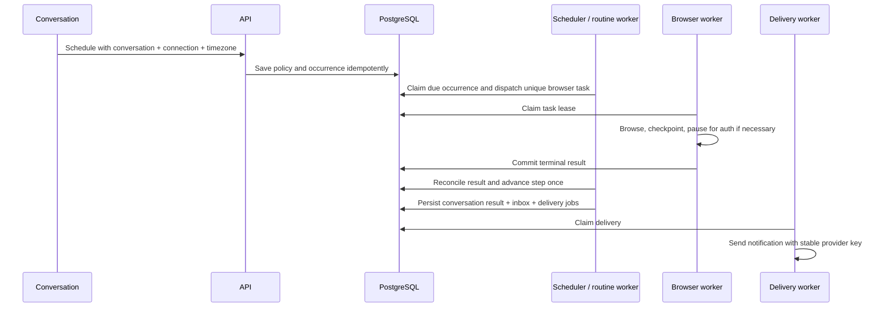

# Open Learn: scheduled cloud browser jobs — technical execution handoff

Date: October 14, 2026. Status: implementation in progress; local core flow verified, hosted activation pending.

## Execution ledger

| Package | Status | Evidence and remaining work |
|---|---|---|
| CJ01 | Baseline inspected | Clean initial main checkout at caf908a; Render inventory showed Virginia paid API and Oregon free rollback API, no Open Learn workers. No secrets logged. |
| CJ02 | Implemented; focused verification | Compiler admits website routines, binds conversation IDs, includes owned cloud connections and rejects device-only execution; new enrollment gate defaults off. Explicit scheduled portal routing and frontend reminder directive are wired; schedule interpretations persist for idempotent retries. Live admission qualification pending. |
| CJ03 | Implemented; local recovery verified | Browser admission and step binding are one transaction. Waiting/auth states persist, terminal reconciliation is filtered/ordered, completion CAS deduplicates continuation, cancellation fences task, overlap is skipped with audit reason. Isolated PostgreSQL 16 recovery and concurrent completion job passed in CI run 38538051411; hosted acceptance remains pending. |
| CJ04 | Result projection implemented | Assignment fingerprints/checkpoints scoped by routine/connection/course; partial results do not advance checkpoint. Actual portal coverage, retention and recurring change-detection qualification remain pending. |
| CJ05 | Implemented; partially verified | Shared loader for full/compact chat, scoped result query, separate attention identity, frozen idempotent Resend retry. Existing browser UI tests passed (10); hook-specific and real email/push/mobile acceptance pending. |
| CJ06 | Configuration prepared | Dedicated roles, scoped overrides, heartbeats; two-worker Blueprint validated against Render schema. User approved up to $14/month incremental workers. Render worker form is prepared. Production credential access is approved and the scoped environment group has been created; worker creation, deploy and handover not completed. |
| CJ07 | Local checks progressing | Initial 13 focused tests passed plus isolated API test; complete local suites: 22 backend tests passed, 18 browser/admission UI tests passed, TypeScript passed. Isolated PostgreSQL 16 recovery and concurrent completion checks passed in CI run 38538051411, along with frontend build and Redis checks. Full backend job and authenticated live-provider acceptance still required. |

See `SCHEDULED_CLOUD_BROWSER_RELEASE_RUNBOOK.md` and `deploy/render-scheduled-browser.yaml`. No application changes are deployed and no worker subscriptions have been created. Do not equate the locally verified paths with the complete production acceptance case.

Verification notes: API TestClient stalled because the sandbox blocked Windows event-loop socketpair creation; the same isolated test passed outside the sandbox. Vitest temporary-file creation was blocked inside the sandbox; outside it, all 10 existing browser-assistant tests passed. These were environment limitations, not discarded failed application assertions. Docker Desktop was started to prepare isolated PostgreSQL, but the engine query did not return; PostgreSQL qualification was subsequently completed in isolated GitHub CI (run 38538051411); local Docker is no longer a prerequisite.

## 1. Objective and scope

Deliver this complete flow: “Every evening, check my connected portal for new assignments and post a summary in this conversation.” The app can be closed. Worker restarts preserve progress. Expired authentication pauses the same execution. Retries cannot duplicate browser runs, conversation results or notifications. Notification failures never repeat a portal check.

Keep Vercel frontend, Render API/worker infrastructure, current PostgreSQL database and SQL queue/scheduler, Browserbase/Playwright, existing object-storage abstraction and notification transports. No database-provider migration, new broker or new sandbox provider. No generated-code task activation. Stagehand is an optional later browser improvement, not a prerequisite for this acceptance case.

The user has authorized implementation of this direction, but requested this technical plan first. Do not interpret this document as approval to purchase additional services. Verify actual production topology before any handover; proposed Blueprint files are not evidence of deployed resources.

## 2. Repository baseline and concrete gaps

Reinspect these paths at implementation time; this audit was read-only and ran no acceptance tests.

| Area | Reuse | Gap / obligation |
|---|---|---|
| Durable jobs | `backend/app/workflow_store.py`: enqueue, claims, leases and idempotency | Confirm PostgreSQL races and restart behavior, not only SQLite tests |
| Schedule | `reminder_service.py`, `reminder_schedule.py`, `reminder_cron.py` | Retain occurrence identity, timezone/DST handling and bounded catch-up |
| Action runner | `reminder_actions.py`: registry, start/execute/resume and step ledger | `resume` treats `waiting_for_user`/`waiting` as failure; must preserve resumability |
| Browser dispatch | Registry `assistant.website_task` calls `AssistantService.create` with stable step key | Persist the link to the created task; recover crash between task creation and ledger update |
| Completion bridge | `ReminderService.reconcile` joins waiting steps to owned `assistant_runs` | Unordered LIMIT 100 includes nonterminal runs: waiting runs can starve completed ones |
| Browser execution | `browser_assistant/service.py`, `workers.py`, `store.py`, `control.py` | Keep browser runtime ownership explicit; do not enqueue in both legacy and agent-v2 runtimes |
| Conversation output | `Notifier.deliver`, `reminder_message` records, `/v1/reminder-messages`, `web/components/learn-chat.tsx` | Ensure scheduled browser summary is the body and appears in the originating conversation; check compact chat too |
| Notifications | `reminder_worker.py` and existing Resend path | Delivery is marked outcome_unknown before sending; current retries finish without resending. Define provider-specific recovery |
| Chat admission | `reminder_routes.py:execute_chat_command`, `reminder_intent.py:compile_reminder` | Compiler prompt excludes website_task. Some deterministic “remind me” branches create a notice rather than execute requested work |
| Worker roles | `hosted_runtime.py`: browser and notifications roles; main.py embedded startup guards | External roles already exist. Switching global worker mode affects other worker types; inventory all before changing it |
| Hosting proposal | `deploy/render.yaml`, `deploy/render-paid.yaml` | Paid proposal includes unrelated services; never sync it wholesale for this feature |
| Sandbox | `agent_execution/sandbox_config.py` | Readiness blocked by lifecycle/metering; leave disabled for this browser release |

## 3. Ownership and durable identities

Exactly one subsystem owns each responsibility:

- Reminder policy owns schedule, timezone, cancellation and future occurrences.
- Reminder fire owns one scheduled occurrence and its action ledger.
- Browser task owns execution, browser actions, retries, authentication handoff and result.
- Reminder completion bridge consumes durable task state and advances the ledger.
- Notifier owns conversation/inbox publication and delivery records.
- Delivery worker owns transport attempts only.

Use existing IDs: policy ID/revision → fire ID → step index → browser task ID → result/delivery ID. Preserve the existing deterministic step dispatch key (owner/fire/step/due time). Repeating a key with changed arguments must conflict. Store original normalized dispatch arguments for retries; never reconstruct them from mutable current settings.

The queue offers at-least-once execution. Guarantee idempotent database effects, not exactly-once browser or external network actions. On unknown browser outcome, reconcile/quiesce the old session and observe current state; do not blindly replay a potentially consequential action.

## 4. Contracts and behavior

### Schedule admission

Reuse `ReminderCreate` and existing routes. Compile a website action followed by `buddy_message`, with explicit `bodyTemplate: '{{summary}}'`. Bind sessionId server-side from the current owned conversation. Select only an owned connection available in supplied scope. Do not let model output invent IDs or choose another user's account.

“Every evening” requires an exact time or an existing explicit preference; ask once if absent. Confirm the time, timezone, website and recurrence in ordinary language. Distinguish “remind me to check” (notification) from “check and tell me” (execution). Preserve current quiz/flashcard scheduling behavior.

Scheduled browser actions require a cloud-capable connection; local-device executors cannot satisfy app-closed execution. Validate at admission and again at dispatch. Missing or expired sign-in creates a resumable task request, not success and not an automatic switch to an unrelated account.

### Browser result

Persist a versioned result with task/fire linkage, observed source references, collected assignment identities, checked-at time, coverage (complete/partial), summary, and safe error code. Reuse existing facts/coverage artifacts where possible. A partial result must identify unchecked areas; never say “no new assignments” after failed coverage.

Define “new” against the last successful covered checkpoint for the same owner/connection/course scope. Prefer portal IDs; otherwise use a reviewed canonical URL/content fingerprint. Do not advance a whole-portal watermark after partial coverage. Store change checkpoints through existing owned records with a reserved kind/version, scoped queries and bounded retention. Source data is untrusted and cannot authorize writes.

### Waiting and cancellation

| Task state | Reminder step behavior |
|---|---|
| queued/resolving/running | Keep waiting; never dispatch another task |
| waiting_for_login / waiting_for_user / waiting_for_device / paused | Keep waiting; expose task link and reason; deduplicate attention notices separately from final result |
| completed | CAS waiting → completed; merge allowlisted result fields; enqueue one continuation |
| completed_partial | Complete with explicit partial coverage; notify honestly |
| failed/cancelled | Apply explicit failure/cancellation policy; never publish a successful summary |

Match actual status names from contracts before coding. Resume through existing request ID + revision-bound browser commands. Late completion after cancellation cannot publish a new routine result. A deliberate per-occurrence stop should cancel the associated active browser task; pausing future schedules must clearly state whether the current run continues. Separate these controls in API and UI.

Prevent overlapping occurrences from accumulating behind expired authentication. Proposed default: one active execution per routine; coalesce missed occurrences to the latest eligible check, retain a skipped/coalesced audit reason, and enforce existing catch-up/expiry bounds. Serialize the decision under the owned policy lock. Do not indefinitely queue one browser per missed evening.

## 5. Implementation work packages

### CJ01 — Baseline and preservation

Read repository instructions and current git status. Inventory deployed process roles, scheduler ownership, browser/private-login flags, region, pool budgets and notification configuration without logging secrets. Identify all entry points that admit scheduled requests. Record current durable states and relevant tests. Keep unrelated changes intact.

Deliverable: short baseline report distinguishing inspected code, configured production and verified behavior. No speed claims from mocks.

### CJ02 — Correct schedule admission

Files: `reminder_intent.py`, `reminder_routes.py`, `reminder_service.py`, browser connection/contracts, existing chat admission integration.

Add website action to the bounded compiler with owned connection context. Validate cloud capability and conversation binding; require read-only scope for this release. Cover ambiguity and explicit reminder-only language. Store stable task arguments. Expose normalized schedule and linked execution metadata through existing owned detail endpoints; no new scheduler.

### CJ03 — Dispatch, resume and recovery

Files: `reminder_actions.py`, `reminder_service.py`, browser service/store as needed.

Preserve waiting states instead of failing the reminder. Use conditional ledger transitions and check affected-row counts before emitting continuations. Ensure browser creation is idempotent across the crash window before ledger persistence. Prefer shared transaction admission through the existing `connection` parameter where feasible; otherwise replay the same immutable key and arguments.

Reconciliation must process eligible terminal work fairly: filter completed/failed tasks separately from attention states, order deterministically, and paginate/bound each pass. Polling persisted terminal state remains the recovery mechanism even if a completion outbox event accelerates it. Inspect failed routine-job reconciliation so an old failed attempt cannot incorrectly fail a newer successful continuation.

Implement overlap/coalescing and cancellation fencing using existing row transactions. No new database provider or queue. If existing tables cannot express a required unique invariant, document and propose a narrowly additive schema migration separately instead of hiding it.

### CJ04 — Honest portal checks and durable results

Files: `browser_assistant/workers.py`, `evidence.py`, adapters, reminder result projection.

Bind task to selected cloud connection. Verify completion against requested coverage, extract stable assignment identifiers and retain evidence. Add scoped last-successful checkpoints for detecting additions/changes. Keep the existing reading policy; unsupported portals return a clear partial/unsupported outcome. Authentication handoff resumes the same task with fresh observations.

Result publication and watermark updates must be transactional or retry-safe. Persist result before notifying. A failed notification never invokes browser preparation again.

### CJ05 — Conversation, attention and notification recovery

Files: `reminder_service.py:Notifier`, `reminder_worker.py`, `reminder_routes.py`, `web/components/learn-chat.tsx`, compact chat and existing browser task UI.

Render durable summary messages in the original conversation after reopening. Reuse task controls and links for sign-in/resume/cancel. Keep one result per occurrence and distinct attention notices; attention must not consume the final inbox uniqueness slot. Avoid putting private portal content in lock-screen notifications. Read persisted results if live event delivery is lost; prefer events plus visibility-aware fallback refresh.

For Resend, verify current idempotency retention semantics before implementing retries. Freeze recipient/from/body on first attempt, use one stable provider key, and retry only within the provider's guaranteed deduplication window. After that window, unresolved outcome needs reconciliation/manual retry policy, not blind resend. Push channels without provider idempotency need separate known-failure versus unknown-outcome handling. Provider acceptance is not proof the learner received/read the message.

### CJ06 — Dedicated Render workers and safe handover

Files: `hosted_runtime.py`, `main.py`, deployment configuration and release runbook.

Reuse `python -m backend.app.hosted_runtime browser` and `python -m backend.app.hosted_runtime notifications` as separate processes. API accepts/persists tasks; it does not own browser execution threads in this production configuration. Browser workers and notification workers may be independently scaled. Keep database/region/storage consistent with current production.

Do not switch `OPENLEARN_WORKER_MODE=external` until every affected existing worker role has an active owner. Either provision all required replacements with approval or introduce narrowly scoped browser/notification worker-mode overrides that preserve other roles. Include startup guards, SIGTERM draining, lease-expiry recovery, database pool budgets and worker heartbeat/queue-lag health reporting. A worker has no HTTP endpoint; health must be observable through owned operational records/metrics.

Prepare only the needed deployment diff; do not activate unrelated cache, cron, class or generation services from the paid proposal. Quote incremental charges and obtain approval before provisioning new paid resources. Stage worker configuration first, drain/fence old ownership, then activate the new owner; document rollback without duplicate execution. Browser credentials remain server-side. No per-user Render service.

### CJ07 — Verification and release qualification

Run focused preservation tests, transactional PostgreSQL tests, and a bounded real-provider acceptance case using synthetic portal data/disposable accounts. Never assume saved-login readiness from a successful public example.com visit. First qualify a controlled portal, then one explicitly authorized real connection. Record commit, environment, flags, counts, timings and limitations.

Release only after the matrix below passes. No sandbox enabling, provider migration or broad deployment bundled into this release.

## 6. Required acceptance matrix

| Scenario | Required assertion |
|---|---|
| App closed before due time | Server dispatches and saves result without client connection |
| Duplicate schedule/admission request | One policy/fire/task for same idempotency key |
| Crash after browser task created, before ledger link | Retry finds same task; no second portal check |
| Crash after browser completion, before routine resume | Reconciliation advances once after restart |
| Two completion reconcilers | One ledger completion, continuation and final result |
| More than 100 waiting tasks | Eligible terminal task is eventually processed; no starvation |
| Expired login | Same task pauses; attention is visible; sign-in/resume can complete routine |
| Resume request from wrong account or stale revision | Denied; no session or result exposure |
| Worker dies during browser action | Old session reconciled; uncertain action not blindly replayed |
| Repeated scheduler ticks / DST / missed occurrence | Correct configured local time, bounded catch-up and no duplicate occurrence |
| Previous occurrence still paused | Coalescing/overlap policy enforced, bounded resource use |
| Partial portal coverage | Partial result; unchecked pages not reported as empty; watermark not over-advanced |
| Same unchanged assignments next evening | No false “new” results; honest no-change summary |
| Cancellation races with completion | Canceled occurrence cannot publish new success or dispatch retries |
| Notification transient failure | Retry delivery only; browser execution count unchanged |
| Provider accepted email but response lost | Stable payload/key; bounded deduplicated retry or explicit unknown outcome |
| Reload original conversation | Exactly one durable summary with working task link |
| Frontend/API deployment during execution | Browser task ownership persists independently |
| Database outage / provider timeout | Bounded backoff, recoverable state, no false success |
| Owner deletion / revoked connection | No further access; jobs and provider resources cleaned up under existing policy |

Suggested test locations: extend `backend/tests/test_chat_reminders.py`, `test_browser_assistant.py`, `test_browser_control.py`; add focused `test_scheduled_browser_jobs.py` and PostgreSQL concurrency coverage. Use fake providers for deterministic failure injection, real Browserbase only for explicitly bounded integration checks. Keep user portal contents out of fixtures/logs. UI tests must cover both supported conversation renderers and mobile handoff.

## 7. Observability, budgets and operational gates

Trace fire ID, task ID, job/attempt ID, routine step, worker role, queue wait, execution time, recovery reason and delivery status. Do not log cookies, credentials or raw private page text. Measure due-to-start and completion-to-visible-result separately from browser execution. Record browser/model usage including failures and abandoned sessions.

Initial proposed operational targets: due-to-start p95 <=30 seconds at declared load; persisted completion-to-inbox p95 <=10 seconds; no duplicate result in race/restart qualification; no unbounded active-session growth. These are targets to measure, not existing guarantees. Provider-dependent portal completion needs its own measured baseline. Pause admission on spend/capacity limits with a clear task status; never silently drop work.

Roll back enrollment on cross-owner exposure, duplicate external effects, repeat task dispatch, lost accepted schedules or uncontrolled resource growth. Keep the compatible reader and completion bridge running to drain accepted tasks. Do not reset tasks to queued as a generic recovery measure.

## 8. Out of scope and follow-on work

Stagehand: after the scheduled flow is qualified, add behind the browser executor boundary for difficult selectors/extraction. Preserve policy enforcement, action receipts, observation revision checks and explicit task outcome validation. Independently improve CDP connection reuse and active tab tracking; do not assume replacing a model loop fixes orchestration.

Daytona: separate release gate for resource caps, cancellation, provider deletion, crash/orphan reconciliation and metering. Leave sandbox readiness disabled until qualified. No E2B addition for this task.

External writes: later explicit approval and reconciliation design. This release reads portal data and writes only Open Learn results plus opted-in notifications. A page cannot authorize new actions.

## 9. Definition of done and coding-agent report

Report each CJ package as implemented, locally verified, hosted verified, or blocked with concrete evidence. Link changed files and test results. List feature flags, rollout and rollback commands, worker ownership inventory and any remaining real-provider verification. Do not call the feature complete based on compilation, mocked tests, an adapter's existence, or a successful public-browser smoke test.

The final proof is a scheduled, authenticated read-only portal check that completes with the app closed, survives an injected worker restart, recovers from expired authentication, publishes one summary in its original conversation, and retries notification delivery without rerunning the portal check.
