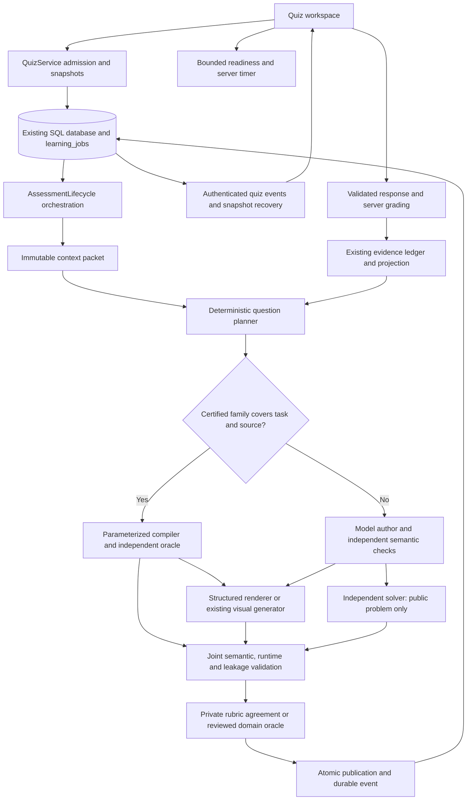

# OpenLearn quiz architecture: assessment quality, latency and visuals

Design status: proposed, not implemented or approved for rollout. Date: October 13, 2026. Revision 2 incorporates the architecture review: hybrid generation, semantic/composition separation, readiness fairness, private storage, powered evaluation and explicit state ownership.

Repository inspected: HEAD `ece49127d2ea678d6a06d04949677d0ad4ba85d3`, including the local assessment timing changes from October 12. The working tree contains prior local timing work. This revision changes only the design document. Hosted configuration and the deployed SHA were not rechecked for this design; do not treat repository defaults or historical observations as current production configuration.

## 1. Decisions and boundaries

Build an assessment pipeline inside the existing Python backend. Keep SQLAlchemy/PostgreSQL, `learning_jobs`, `WorkflowStore`, the transactional outbox, usage accounting, `AssessmentLifecycle`, `QuizService`, and the unified evidence ledger. Extend the existing Next.js quiz workspace. No new broker, database, independent planner service, or general agent framework is required.

The recommended changes are:

1. Admit quiz creation and first-question preparation as one durable operation from the client's perspective. Persist the quiz immediately and prepare its first question outside a transaction.
2. Deliver state changes through an owned, replayable quiz event stream, with snapshots and polling as recovery paths.
3. Introduce a versioned assessment specification, with explicit private solution/verification data and an allowlisted public presentation. Preserve existing v1/v2 sessions through their existing handlers.
4. Plan reasoning tasks and evidence requirements deterministically. Use models for semantic authoring, genuinely independent solving, rubric review and written grading. Use deterministic checks wherever their applicability is explicit and their implementation reviewed.
5. Support precise structured diagrams first, then bounded interactive widgets. Reuse generated visuals only through an assessment-specific validation and publication policy.
6. Add a hybrid factory: certified parameterized families use a deterministic compiler and independent oracle with zero per-instance model calls. Novel or source-specific semantic tasks retain model authoring, independent solving and rubric agreement. Enable each certified family only after its coverage and quality gates pass.
7. Warm immutable context while the student answers; choose the next adaptive objective after the answer is committed. Keep one validated private candidate during feedback. Full speculative branches remain off by default.
8. Use a bounded readiness protocol for required visuals and server-authoritative timers. A browser acknowledgement is an operational signal, not proof that the student did not already inspect a question.

No speed improvement is claimed here. The critical-path equations below describe possible savings, not benchmark results. Model names and effort settings remain pinned to the actual production baseline until an experiment wins.

## 2. Verified current architecture

Paths below are repository-relative. Function names are stable navigation anchors; line numbers would drift with the concurrent local work.

| Area | Actual implementation and input/output | Consequence |
|---|---|---|
| Launch | `web/components/quiz-workspace.tsx`, `start` and launch effect: optional study-note save → `workflow('/quizzes')` → `getQuiz` → separate `/next` → `getQuiz` | First question traverses two commands and repeated reads. |
| Command transport | `web/lib/learning-workflows.ts`, `workflow`, `waitForJob`: persists command key/job pointer, POSTs, polls every 1,200 ms, restores after reload | Durable recovery exists; completion recognition may lag a polling interval plus network time. |
| Admission/worker | `backend/app/learning_routes.py`, `build_learning_router`, `run_job`; `workflow_store.py`, `enqueue`, `claim`, `validate_lease`, `validate_input` | Owned idempotent commands, input revisions, leases, retries and cancellation are reusable. |
| Scheduling | `workflow_store.py`, `_enqueue`: ordinary interactive default priority 50, batch default 0; quiz prefetch explicitly priority 5 | Priority exists; priority alone does not reserve capacity or preempt running work. |
| Session | `quiz_service.py`, `create`; `quiz_policy.py`, `session_plan` | Source/conversation snapshots, graph versions, modes, feedback policy and role profiles already persist. Flags are session snapshots, not a universal retroactive toggle. |
| Planning | `adaptive_question_planner.py`, `choose_question_plan` | Coverage-first selection; assisted success, due retrieval, demonstrated evidence and bounded uncertainty diagnostics influence objectives. v2 rotates reasoning tasks and requested complexity. This is a heuristic, not demonstrated learning-effectiveness or calibrated ability estimation. |
| Context | `QuizService.prepare`: attempts, item history, graph, unified state, retrieval or study-context fallback, source manifest, canonical evidence, `LearningControlPlane.prepare` | Several reads and context assembly steps precede authoring. Current code reads all owner items before replacing that result with quiz-scoped history for sessions with a plan; this is a concrete avoidable read to profile and remove. |
| Generation | `assessment_generation.py`, `generate_item`; `assessment_context_planner.py`, `plan_assessment_context` | One author candidate, deterministic gates, independent solve without author key, then solution/rubric comparison for short or v2 questions. Up to three candidate attempts. |
| Deterministic gates | `deterministic_quality_failures`, `Candidate.coherent`, `assessment_numeric.py` | Source membership, approximate duplicate stems, option uniqueness/leak patterns, weighted rubric consistency and bounded arithmetic checks. These do not prove semantic grounding or conceptual depth. |
| Model profiles | `assessment_profiles.py`, `profile_snapshot`, `resolve_provider`, `complete` | Separate author, verifier and evaluator profiles with version hash, token limits, timeout, strict schema and pinned tariffs. Defaults author high effort; others medium. Actual hosted settings require capture. |
| Publication | `AssessmentLifecycle.commit_presentation`, `QuizService.commit_prepared` | Approved item, private solution, public presentation and exposure committed under revision/source/lease checks. Existing answering timer starts during publication. |
| Grading | `AssessmentLifecycle.evaluate_response`, `assessment_generation.evaluate`, `QuizService.grade/commit_grade` | Choice-only exact-set grading; written rubric grading; choice rationale can trigger model evaluation; inconsistent or unsupported credit becomes uncertain. Submission reservation excludes grading wait from the v2 answering timer. |
| Evidence | `evidence_ledger.py`, `EvidenceLedger`; `unified_learner_state.py`, `reduce_capability` | Assistance, unresolved attribution, disputed/uncertain results, family/session variety and delayed retrieval matter. `demonstrated_enabled=False` in the inspected default policy deliberately prevents automatic mastery promotion. |
| Prefetch | `QuizService.commit_grade`, `prepare`, `commit_prefetch` | Optional post-grade prefetch during feedback. Candidate keyed by quiz revision; source/evidence/control-plane checks precede promotion. Existing cache is one private candidate, not a public question bank. |
| Disputes | `assessment_adjudication.py`, `ChallengeService.prepare/commit` | Independent review, source checks and append-only correction/reprojection; deferred exams restrict review before finish. |
| UI | `assessment-card.tsx`, `quiz-workspace.tsx` | Text/choices/written response, hints, assisted flag, local drafts, feedback, flagging, pause/resume. No typed visual-answer contract in `AnswerCommand`; `Candidate.kind` is single/multiple/short. |

Current source display deserves explicit policy: `AssessmentCard` exposes reference links. Future closed-resource assessments must not accidentally expose worked solutions through source viewers, hints, alt text, lesson artifacts or visual controls. Keep an explicit open-resource practice policy; do not silently transform current practice into a closed exam.

### Current critical path

```mermaid
sequenceDiagram
  participant U as Quiz UI
  participant A as API
  participant W as Existing worker
  participant D as Database
  participant M as Model provider
  U->>A: POST quiz command
  A->>D: Enqueue create
  W->>D: Create quiz and finish command
  loop 1200 ms plus request time
    U->>A: Read job status
  end
  U->>A: GET quiz
  U->>A: POST next command
  W->>D: Claim, load state and sources
  loop Up to three candidate attempts
    W->>M: Author
    W->>W: Deterministic checks
    W->>M: Independent solve
    W->>M: Solution and rubric agreement for v2
  end
  W->>D: Validate and publish; start timer
  loop 1200 ms plus request time
    U->>A: Read job status
  end
  U->>A: GET quiz and render
```

### Measurement status

The local `assessment_timing.py` instrumentation separates author/check/agreement/grading, inclusive prepare, publication, command, and queue age. `assessment_timing_report.py` summarizes exports. It is not a complete hosted baseline: queue age on retries includes earlier execution/backoff, model completion is not quality approval, and nested spans must not be summed. Frontend render/delivery timing, per-attempt semantic outcomes, prefetch use/waste and query correlation remain missing. October 12 focused tests passed; broader workflow tests stalled and are not evidence of passing integration. No new measurements were run for this design.

## 3. Existing visual infrastructure: reuse with stricter assessment policy

There are two useful paths, not one universal visual agent:

| Path | Verified code | Reuse/change |
|---|---|---|
| Structured visuals | `visualization_models.py`: bounded chart/function/diagram/science/timeline/simulation specifications, expression validation; `visualization-*.tsx`: renderers; `visualization_service.py`: owned revisioned updates | Reuse chart/function primitives and reviewed simulation math. Add assessment-safe projections and specific domain schemas. The current general schema does not establish a complete circuit/netlist, geometry-proof or biological-labeling assessment system. |
| Generated visuals | `openintelligentui.py`: adapter to existing runtime/sidecar, scoped internal tickets, metered model proxy, output/attempt/deadline bounds; `visual_runs.py`: durable owned child jobs, artifact revisions, lesson publication | Reuse provider transport, accounting, bounded generation, revision storage patterns and verifier assets. Add assessment target support; do not attach assessment artifacts to a fake lesson or reuse lesson publication directly. |
| Static code checking | `visual_code.py`, `validate_visual_code` | Parses/validates generated code and DOM targeting. Syntax validity is not scientific validity. |
| Runtime verification | `visual_verification.py`: headless Chromium, network allowlist, bounded probes, desktop/mobile views, controls/readouts/error checks | Reuse runtime tests. Required assessment visuals must fail closed if the kit/browser/checks are unavailable; a tutoring fallback is insufficient. |
| Science checks | `visual_science.py`: topic-routed formula/readout checks for selected physics/simulation topics | Useful diagnostics. Some probes identify values through labels and may return `unmeasured`; some accept any matching readout. Add exact semantic-entity bindings and independent domain oracles before using these as assessment gates. |
| Screenshot judge | `visual_judge.py`: optional metered multimodal review; failure returns no judgment; issues are repairable warnings | Reuse as supplementary review, never the sole semantic gate. Its source-file statement about earlier evaluation is not independently verified by this audit. |
| Browser isolation | `generated-visual/upstream/renderer.tsx`, `frame-content.ts`, `websandbox-loader.ts` | Existing isolated frames and restricted CSP are useful. Current final CSP has `connect-src 'none'`, restricted scripts and some remote image origins. Assessments use a tighter dedicated profile, not inherited remote images or chat sandbox callbacks. |

Current visual model selection is configured through `OPENLEARN_VISUAL_MODEL` with provider fallback, optional visual routing model and optional judge model. Defaults in code are not proof of hosted choices. Existing visual generation permits comparatively large output/deadline/repair budgets; do not reuse its default 600-second run deadline as an acceptable synchronous quiz budget.

Interactive sliders/readouts exist. Server-authoritative interactive assessment grading, answer-state schemas, readiness/timer contracts and private-answer isolation are new work.

## 4. Proposed component map and execution



These boxes are modules/functions and existing job handlers, not separately deployed services.

| Component | Exact input → output | Internal behavior and reuse | Cost/latency implication |
|---|---|---|---|
| Admission | owner, QuizCreate, idempotency key → quizId, preparationId, snapshot, event cursor | Existing ownership/policy checks; short transaction creates quiz and enqueues preparation atomically | Removes client orchestration round trips; no model call |
| Context packet | authorized source revision refs, quiz scope, graph revision → immutable bounded sources + objective catalog + provenance digest | Existing retrieval/manifest/context compiler; separate immutable source data from dynamic learner evidence | Warm/reuse source packet; never cache ownership authorization |
| Planner | current evidence watermark, scope, attempts, packet, policy → QuestionPlanV3 | Deterministic eligibility and scoring below; reuse coverage/diagnostic guardrails | No planning LLM in initial release |
| Author | plan + selected sources + prior reasoning signatures → CanonicalAssessment | Existing author with stricter typed output and grounded claims; bounded repair | Model route only; certified compiler route avoids authoring calls |
| Renderer | public stimulus specification + renderer version → immutable artifact bundle and semantic manifest | Deterministic preferred; generated path only for enabled families | Deterministic route avoids visual-model call; generated route adds latency/cost |
| Independent solver | public problem, stimulus semantics, authorized sources → independent answer and reasoning/check result | No author answer, rubric, repair history containing solution, or grader data | One existing call; concurrency with rendering possible only for trustworthy structured semantics |
| Joint validation | candidate, independent result, exact artifact bytes, constraints → validation attestation or rejection codes | Domain oracles, independent agreement, render/interaction/leakage/a11y checks | Additional local work; risky generated cases may require separate semantic review |
| Publication | approved build + current revisions + valid lease → immutable presentation and ready event | Existing lifecycle transaction, immutable private solution, artifact bindings | Short DB transaction; never call provider/browser in it |
| Readiness | presentation/artifact digest, attempt ID → authoritative answering state/deadline | Mode-specific preflight, disclosure and attempt policy below | Small authenticated round trip; bounds missing acknowledgements |
| Grader | frozen accepted response + private grading contract → criterion outcomes + evidence eligibility | Existing deterministic choices and written evaluator; new domain graders | Choice/widget arithmetic avoids LLM; semantic written answers retain evaluator |
| Evidence/adaptation | accepted grade, assistance, family, provenance → ledger event and projection watermark | Existing ledger/reducer; no independent mastery store | Existing transaction and bounded projections |
| Preparation coordinator | committed outcome + remaining coverage + immutable packet → one next private candidate | Existing prefetch, single-flight execution and supersession | Hides preparation during feedback; wasted work explicitly metered |

### Proposed sequence, including asynchronous dependencies

```mermaid
sequenceDiagram
  participant U as Quiz UI
  participant A as API
  participant D as DB / durable jobs
  participant W as Assessment worker
  participant M as Models
  participant V as Visual renderer / verifier
  U->>A: POST quizzes (startImmediately, idempotency key)
  A->>D: Atomic quiz creation + prepare job + event
  A-->>U: 202 quizId, snapshot, cursor
  U->>A: Subscribe to quiz events after cursor
  W->>D: Claim prepare; load packet + current evidence
  W->>W: Select plan
  alt Certified family
    W->>W: Compile instance; independent oracle and parameter checks
  else Novel or semantic task
    W->>M: Author canonical assessment
  W->>W: Validate schema, grounding and answer boundaries
  par Structured visual path
    W->>V: Render public stimulus + verify exact semantics
  and Independent solving
    W->>M: Solve public problem without private key
  end
  W->>W: Check independent result; domain oracle where supported
  opt Rubric semantics require model comparison
    W->>M: Compare private rubric with independent solution
  end
  end
  W->>V: Complete joint attestation for exact artifact digest
  W->>D: CAS publication + ready event (same transaction)
  A-->>U: Safe preparation status (no timed question content)
  U->>U: Preflight general renderer assets and input capability
  U->>A: Begin timed presentation, or acknowledge untimed readiness
  A->>D: Atomically record disclosure/start once for timed mode
  A-->>U: Public question bundle, server deadline and revision
  U->>A: POST bounded response + expected revision
  A->>D: Freeze response and acceptedAt; enqueue grade
  W->>M: Written evaluator only when required
  W->>D: Grade + evidence + feedback event + prefetch admission
  A-->>U: Feedback (or submitted status in deferred exam)
  W->>D: Prepare next question while student reads feedback
```

For generated diagrams whose pixels define information not captured in a reviewed structured schema, independent solving must wait for the rendered artifact and include it. They cannot use the concurrency shortcut shown for the structured path. Any semantic visual repair invalidates the solver/agreement attestation and repeats dependent checks.

## 5. Question quality beyond prompts

### 5.1 Contract-driven construction

Extend `QuestionPlan` with `assessmentVersion=3`, `taskFamily`, `requiredEvidence`, `misconceptionTargets`, `prerequisiteIds`, `requestedComplexity`, `responseContractKind`, `visualRequirement`, `sourcePolicy` and `planningPolicyVersion`. Make these constrained enums/references with budgets, not arbitrary instruction strings.

A task family defines the reasoning operation and the evidence needed to distinguish understanding from surface matching. Start with explain, predict-with-reason, diagnose-error, compare-claims and transfer. Add quantitative solve-with-units and interpret-data only with supported grading contracts. A question can be hard because it combines supported concepts; it must not become hard through missing assumptions or unrelated prerequisites.

Author output must include a private claim-to-source map, expected misconceptions and distractor-to-misconception mappings, explicit assumptions, intermediate dependencies for multi-step tasks, criterion-specific acceptable alternatives and a public stimulus. Grounding checks verify that cited spans are in the authorized packet AND that governing claims are supported. Novel scenarios may be invented; governing facts cannot be invented. Unsupported material returns `needs_material`, with no fabricated quiz or learning failure.

Preserve conversation-only practice: existing `QuizService.study_context` marks its fallback as not independently verified. Add `sourceAuthority='reviewed_reference'|'uploaded_unreviewed'|'conversation_context'` to the private contract and public provenance label. A model's agreement with generated study context does not upgrade that authority. Conversation-based practice can continue with honest provenance and existing evidence restrictions; a family requiring validated scientific facts needs reviewed reference material/domain rules before stronger evidence claims. Course task links, Learn launch note ownership, accepted mode-transition IDs and return-to-lesson behavior continue through the existing launch contract.

Reasoning signatures are structured tuples `(concept, taskFamily, governingRelation, misconception, scenarioFamily)`. Penalize repeated signatures before authoring; retain existing stem similarity and independent novelty review afterwards. A semantic embedding index is optional only after measured duplicates justify it. Never treat changing names/numbers as a new reasoning family for mastery evidence.

### 5.1a Hybrid question factory and certification

| Decision | Model-authored route | Certified parameterized route |
|---|---|---|
| Best fit | Novel source interpretation, argumentation, semantic reasoning | Supported quantitative, algorithmic, graph and engineering tasks |
| Construction | Model authors a grounded specification | Reviewed compiler instantiates a family |
| Independent check | Blind model solve plus rubric agreement | Separately implemented oracle and per-instance invariants |
| Main advantage | Flexible coverage | No generation inference wait; reproducible instances |
| Main limit | Provider latency/cost and correlated errors | Review/development cost and bounded domain coverage |
| Difficulty evidence | Observed outcomes conditioned on task/cohort | Observed outcomes conditioned on family, parameters and cohort |


Routing is deterministic from objective, task family, authorized source claims, response contract and available certified coverage. A registry entry contains family ID/version, objective and reasoning signature, allowed parameter domain, source requirements, compiler version, independently implemented oracle version, rubric version, visual schema/renderer versions, ambiguity predicates, review evidence and revocation status. Route choice and versions are private build provenance. Unsupported inputs fall back to the semantic pipeline; they never silently weaken checks or change the selected objective.

Certification requires independent subject review of the family, solution derivation, wording, rubric, distractors and assessed construct; known reference cases; boundary/property and invalid-input cases; and a separate oracle implementation that does not reuse the compiler's answer routine. Reviewers must inspect assumptions and allowed parameter regions, not merely approve a few examples. Every instantiated question rechecks units, finite values, solvability, unique intended answer or declared alternatives, distractor distinctness, rounding/tolerance boundaries, semantic bindings and actual visual artifact. Failed certification or revocation disables new instances and identifies affected history for adjudication.

A private reproducible seed selects only allowed parameter regions. Parameters can alter reasoning difficulty: avoid accidental simplifications, degenerate topology, trivial cancellation and unreadable geometry. Include prediction, error diagnosis, reverse inference and transfer families rather than just number substitution. Track exposure by reasoning signature as well as stem. Store parameter strata and selection propensity for calibration; family averages are conditional on learner population and adaptive selection. No intrinsic difficulty claim follows from template reuse.

A certified route may use a previously reviewed composition and no visual model. Asking a model to compose a new layout makes that build a model-assisted route with separate metering; do not label it zero-call. Semantic novelty, unsupported source-specific claims or an uncovered rubric returns to independent model review. Offline family review amortizes work; it does not eliminate per-instance validation.

### 5.2 Deterministic adaptive selection

Retain current coverage feasibility and scope as hard constraints. If the number of remaining slots equals the number of untouched required concepts, choose an uncovered concept. Exclude changed/deleted sources, unsupported visual families, exhausted exposure limits and unmet prerequisites that would make the task uninterpretable. A prerequisite repair outside the agreed quiz scope becomes a separate suggested activity, not a silent change in scope.

Keep `choose_question_plan` as the active baseline. Evaluate the following candidate utility only in shadow mode:

```text
U(plan) = 4*coverageGap + 3*recentMisconception + 2*retrievalDue
          + 2*needsIndependentConfirmation + transferReadiness
          - 3*repeatedReasoningFamily - 2*prerequisiteRisk
```

Features are bounded to [0,1], computed only from eligible evidence; weights are unvalidated experimental values, never initial production defaults. Resolve ties by least exposure, then stable plan ID. Record feature values and selected policy version privately for reproducibility. Shadow agreement is diagnostic, not a release gate for learning benefit. Enable only after a preregistered randomized comparison demonstrates acceptable delayed unassisted retention/transfer, coverage, dropout and subgroup outcomes. Immediate quiz accuracy alone cannot qualify this policy. Keep uncertainty diagnostics capped by the current session budget and suppress diagnostic branching during deferred exams.

Do not infer guessing from speed alone. A correct choice is evidence of selection accuracy, not proof of reasoning. Use a fresh independent prediction/explanation/transfer task when coverage allows. Rationale disagreement, assisted success and inconsistent repeated results identify follow-up needs; they do not justify punitive scoring or fabricated certainty.

Reuse `UnifiedLearnerState`. Keep demonstrated-state promotion disabled until its existing validation trigger is met. New visual/interaction evidence must carry resolved concept attribution, reasoning family, assistance and policy version; otherwise it remains excluded or tentative under existing rules. A generated question's model-rated difficulty must never directly upgrade learner mastery.

### 5.3 Difficulty calibration

Store two separate concepts:

- **Requested design complexity:** number of conceptual steps, novelty, scaffolding and prerequisite depth chosen before generation.
- **Empirical item/family difficulty:** estimated from independent first attempts on stable reviewed versions, with sample size and uncertainty.

For initial descriptive binary reporting use a Beta(1,1) smoothed success rate, `(correct+1)/(eligible+2)`, with an interval. It describes the observed cohort and selection policy, not intrinsic item difficulty. Exclude assisted, disputed, repeated, source-invalid and uncertain attempts; keep partial-credit distributions separately rather than rounding them into correct/incorrect.

Fresh unique generated items rarely obtain enough responses for item calibration. Aggregate only reviewed equivalent task families/parameter ranges, label family-level estimates clearly, and monitor heterogeneity. Use randomized approved anchor items within eligible scope to reduce adaptive-selection bias. Do not pool across different concepts, material versions or substantially different diagrams.

Defer Rasch/IRT or knowledge tracing. A future Rasch model `P(correct)=sigmoid(theta-b)` requires anchored scales, overlapping response data, item-fit/DIF checks, stable item families and held-out predictive advantage over the existing reducer. Introduce it only if it improves calibration and selection outcomes without increasing failure rates across learner groups. No calibrated ability score is part of initial implementation.

### 5.4 Verification policy

The initial policy retains three semantic stages for existing v2 questions. For v3, a versioned policy selects equivalent checks:

| Family | Required independent check | Agreement/grade strategy |
|---|---|---|
| General written/conceptual | Blind model solution + source/depth/ambiguity checks | Separate rubric/solution agreement model; written evaluator |
| General choice | Blind model solution + distractor and source checks | Preserve v2 rubric agreement until evaluated alternative approved; exact-set choice score |
| Certified parameterized family | Independent reviewed oracle derives result from public givens; parameter, ambiguity and construct checks run on every instance | Compiler replaces authoring; oracle and certified rubric replace per-instance model solving/agreement only within certified support. Zero generation model calls; written reasoning can still require model grading. |
| Biology/anatomy or other semantic illustrations | Reviewed asset/entity mapping + independent semantic review | If the required structure cannot be verified, reject visual family or use a previously reviewed equivalent asset; no automatic trust from appearance |
| Generated visual problem | Solve the actual public artifact and problem; domain invariants where available | Semantic and rubric review plus runtime/security checks; no generic fast-path exemption |

A domain oracle must not reuse the author's answer or the exact renderer calculation as its independent reference. Cross-check equations/topology with a separately tested implementation and known cases. Require explicit applicable assumptions. A deterministic arithmetic check does not prove the question tests the intended concept; keep that independent semantic gate.

Repair policy: at most three authored candidates total, as today, with one active candidate per preparation. Rejection codes distinguish schema, unsupported premise, wrong solution, ambiguity, leakage, duplicate family, visual topology, unit/geometry mismatch and runtime failure. Deterministic serialization/layout repairs may preserve semantic hash; changed givens, labels, options, geometry or rubric require new dependent attestations. Do not reuse a passing checker after substantive repair. Charge every attempt, preserve private rejection artifacts, and return a useful failure if exhausted. Transport retries do not reset the candidate/cost budget.

### 5.5 Grading

Define deterministic grading by response contract, not by the visual's runtime. Selected sets preserve exact-match behavior; do not silently introduce negative marking or partial credit. Numeric answers parse bounded decimal + unit, compare with `abs(actual-expected) <= max(absTolerance, relTolerance*abs(expected))`, and enforce dimension equivalence with a reviewed unit registry. Graph/topology/order tasks use the private rules described below.

Written grading retains weighted criterion scores `score = sum(weight_i * score_i)`, unique complete criterion coverage, accepted-alternative reasoning and exact quoted response evidence. Evidence offsets may be repaired only by unique exact quote matching as today. Model uncertainty, incomplete rubric or unsupported credit produces uncertain feedback, not a wrong answer. An invalid question is excluded from scoring and timer/quiz policy compensation; it is not a learner mistake.

Equivalent paraphrases, correct unconventional solutions, empty responses, distractor misconceptions, partially correct multi-step work and answer-embedded instruction attacks belong in the grading test corpus. Freeze raw accepted input and rubric version; regrades append a resolution rather than overwrite history. A response hash deduplicates identical submissions, not semantically similar learners' answers. Deferred exams withhold solutions, criterion-level revealing feedback and learning-state release until existing finish policy allows them.

## 6. Assessment and visual contracts

Use Pydantic models in `assessment_models.py`/a focused `assessment_visual_models.py`, and generated or manually synchronized TypeScript discriminated unions. Reject unknown fields at trust boundaries. The following are representative shapes; names are design decisions, not code already present.

```typescript
type VisualRequirement = 'none' | 'optional' | 'required';
type ResponseKind = 'single' | 'multiple' | 'written' | 'numeric'
  | 'region_selection' | 'ordering' | 'connections' | 'parameter_state';

// Server only. Never serialized by a generic model_dump into a public route.
interface CanonicalAssessment {
  version: 3; buildId: string; planId: string; sourceManifestId: string;
  sourceRevisionDigest: string; evidenceWatermark: number;
  publicProblem: PublicProblem;
  stimulus: StimulusSpec | null; // public givens only, not the expected answer
  privateSolution: SolutionContract;
  privateGrounding: ClaimSourceBinding[];
  policyVersions: { planner: string; verifier: string; grader: string };
}
interface PublicProblem {
  stem: string; options: {id:string; label:string}[];
  response: PublicResponseSchema;
  visualRequirement: VisualRequirement;
  resourcePolicy: 'open_reference' | 'closed_reference';
}
// Timed pre-disclosure snapshots use a separate status envelope with no problem/artifact.
// This shape is returned only after disclosure, or for untimed practice.
interface PublicPresentation {
  version: 3; id: string; itemVersion: number; quizRevision: number;
  state: 'loading_required' | 'answering' | 'checking' | 'feedback' | 'submitted';
  problem: PublicProblem;
  artifact: null | {id:string; revision:number; sha256:string;
    renderer:string; rendererVersion:string; url:string; alternativeText:string};
  readiness: {attemptId:string; policy:'untimed'|'timed'; preflightExpiresAt:string|null} | null;
  clock: {serverNow:string; deadline:string|null; remainingSeconds:number};
}
interface VisualAnswer {
  presentationId:string; expectedRevision:number;
  artifactId:string; artifactRevision:number; artifactDigest:string;
  responseSchemaVersion:number; clientSubmissionId:string;
  response: {kind:'connections'; edges:[string,string][]}
    | {kind:'region_selection'; entityIds:string[]}
    | {kind:'ordering'; entityIds:string[]}
    | {kind:'parameter_state'; values:Record<string,number>};
  explanation?:string; externalHelp:boolean;
}
```

Concrete public circuit stimulus:

```json
{
  "schemaVersion": 1,
  "domain": "circuit_rc",
  "renderer": "circuit_svg_v1",
  "nodes": ["ground", "supply", "switched", "junction"],
  "components": [
    {"id":"source","kind":"voltage_source","positive":"supply","negative":"ground","value":5,"unit":"V"},
    {"id":"switch","kind":"ideal_switch","ports":["supply","switched"],"initialState":"open"},
    {"id":"resistor","kind":"resistor","ports":["switched","junction"],"value":10000,"unit":"ohm"},
    {"id":"capacitor","kind":"capacitor","ports":["junction","ground"],"value":0.0001,"unit":"F"}
  ],
  "initialConditions":{"capacitorVoltage":0},
  "switchEvent":{"componentId":"switch","timeSeconds":0,"state":"closed"},
  "visibleLabels":["source","switch","resistor","capacitor"],
  "response":{"kind":"numeric","unitChoices":["s","ms"]}
}
```

The stem asks for the time constant and reasoning. The private contract records `tau=R*C=1s`, tolerances, allowed units and rubric; none is in browser payloads. Public physics givens necessarily allow a knowledgeable student to derive the answer; that is intended. Avoid revealing computed targets, highlighted correct regions, `correct=true` metadata, answer-containing filenames, accessible descriptions or simulation readouts that directly perform the assessed task.

Interaction schemas contain only permitted entity IDs, parameter ranges, maximum cardinality and input types. They do not contain correct edge sets, hidden targets or grading weights. Use separate response-validation schema and private grading contract so JSON schema enum constraints cannot leak the correct answer subset.

## 7. Visual generation, correctness and interaction

### 7.1 When to use a visual

Planner chooses requirement deterministically from the selected task family. `required` means the assessed information is spatial, graphical or encoded in data; `optional` means all necessary information is already in the stem; `none` is the default for tasks without demonstrated benefit. Author may propose a visual but cannot override the family capability allowlist or make an unverified optional artifact required during publication.

An optional illustration must pass checks before it appears and should be frozen for the attempt. Do not inject a late illustration that changes interpretation while a student answers. If optional generation misses the build deadline, omit it before publication. A required visual failure blocks answering and triggers bounded repair/replacement.

### 7.2 Domain strategies

| Domain | Initial implementation | Semantic oracle and limitations |
|---|---|---|
| Functions/charts/probability | Reuse structured chart/function renderer; add units, domains, sampling policy and semantic entity IDs | Independent expression evaluation at fixed/property-test points; axes and units consistency; discontinuities must break curves, not bridge them; distributions normalized within declared tolerance |
| Circuits/logic | New reviewed SVG renderer from typed netlist; reuse visual frame/assets | Graph connectivity, component orientation, dangling ports, explicit junctions versus crossings; DC nodal analysis for supported linear networks, RC closed forms for reviewed topologies; Boolean truth-table checks for bounded logic. Unsupported components reject, not approximate silently |
| Geometry/vectors | New structured primitives/constraints over existing diagram infrastructure | Coordinate/angle/length constraints with units and degeneracy checks; marks distinguish given from inferred properties; not-to-scale declaration where appropriate |
| Motion/waves | Extend reviewed simulation families | Analytic reference cases and invariants, initial/boundary conditions, unit checks and fixed deterministic timesteps; arbitrary simulation-code authoring not enabled initially |
| Biology/chemistry | Reviewed owned/licensed image or structured asset with curated entities and provenance | Entity-label/relationship checks against reviewed asset metadata; chemistry requires valence/bond/stereochemistry support before enabling such questions. No automatic anatomical or molecular validity from a generic image judge |
| CS/engineering diagrams | Typed arrays/trees/graphs/logic/block diagrams and bounded traces | Run reviewed algorithm on canonical input server-side, compare state transitions, graph invariants and stable node IDs; do not expose the hidden target trace |

This enables broad subject coverage incrementally; it does not promise universal scientific verification. New domain packs require fixtures, oracle coverage and independent review before publication capability is advertised.

### 7.2a Visual agent composition contract

The question engine owns semantic entity IDs, connectivity, physical values, labels, coordinates where meaningful, data and allowed state transitions. The visual agent receives only this public semantic manifest, its digest, presentation constraints and an allowlist of widget types. Its output is a closed `CompositionSpec`: entity-to-layout bindings, cosmetic positions where position is not assessed, approved style tokens and approved interaction bindings. It cannot add/remove entities, change graph coordinates or circuit connections, invent labels, expose solutions or introduce arbitrary event code.

A reviewed renderer combines semantics and composition. Reject unknown IDs, semantic overrides, occlusion, misleading scale, inaccessible controls and unapproved hints. Bind attestation to semantic digest, composition digest, renderer version and final artifact digest. Layout that changes inferred meaning is a semantic change and requires renewed independent verification. The RC example now models the switch and references its ID in the switching event; the diagram must show its actual ports and initial/event states.

Complex generated static artifacts remain available when domain checks and independent review cover the actual artifact. The existing visual agent can produce constrained compositions or such static candidates through an assessment adapter. Arbitrary generated interactive JavaScript remains deferred; reviewed widgets support agent-chosen bounded interaction design. Neither sandbox execution nor aesthetic approval proves factual correctness.

### 7.3 Joint attestation

Persist an immutable validation attestation bound to:

```text
SHA256(canonical public problem + public response schema + exact artifact digest
       + private solution version + source revision digest
       + renderer version + oracle version + verification policy version)
```

Checks: (1) authorized/current sources and supported claims; (2) solution and rubric correctness; (3) public givens match canonical semantics; (4) actual rendered labels/shapes/control IDs match the semantic manifest; (5) domain oracle assertions; (6) question/visual answer-leakage review; (7) desktop/mobile runtime, keyboard and fallback usability. Required checks have `pass/fail/unmeasured`, with `unmeasured` blocking publication. Artifacts cannot be substituted after approval without re-attestation.

For deterministic renderers, establish renderer equivalence through fixtures and property tests, then validate each input domain and output manifest. Do not pay for a screenshot model on every approved chart. For generated diagrams, use a rendered-image semantic check in addition to domain assertions; if the domain cannot be verified, require human-reviewed reusable artifacts or decline that format. A model judge is fallible; benchmark it against seeded technical defects and expert labels and document residual risk.

### 7.4 Server-authoritative interactive answers

The parent owns controls, draft lifecycle, submission and network access. Prefer reviewed React/SVG widgets over arbitrary generated JavaScript. A widget emits only a bounded response object. Parent validates shape for UX; API independently validates ownership, live presentation, artifact version/digest, schema version, ranges, finite numbers, allowed entity IDs, size and cardinality. Deduplicate selected IDs/edges or reject duplicates consistently; reject unknown fields. Cap response JSON at 16 KiB, graphs at 32 nodes/64 edges, selection/order at 64 entities, numeric parameters at 16. These are initial safety/complexity budgets, configurable only by versioned family policy.

Private graders compare region IDs, topological equivalence, valid precedence order, numeric constraints or simulated outcomes. Graph grading canonicalizes undirected edges, preserves directed edges, and maps only allowed ports; layout coordinates do not establish electrical connectivity. Ordering allows all topological sorts satisfying the private precedence relation rather than one hardcoded list. Parameter tasks recompute outcomes from server formulas and declared bounds; client readouts/scores are ignored. Symbolic equivalence requires an allowlisted bounded parser; random sample equivalence alone is not a proof for arbitrary expressions.

Return criteria-based feedback through normal grade publication. Persist the submitted final state, renderer version and any bounded trace needed by the task; do not continuously upload mouse movement. If a task evaluates a sequence, use a bounded ordered action list and replay server-side. A browser cannot prove that an unrecorded action never occurred, so do not use interaction telemetry as high-stakes proctoring evidence.

### 7.5 Isolation and resource bounds

Initial assessed interactions use reviewed components. Generated code is restricted to pre-rendered static output in this release. Server verification uses a disposable browser context/process in an isolated worker subprocess with no credentials, no API access, denied network except local reviewed assets, read-only asset directory, temporary workspace, 10-second wall deadline per candidate verification and process memory/CPU bounds in deployment configuration. Timeout or missing isolation capability rejects the artifact. Validate these proposed budgets against fixtures before rollout; do not silently disable Chromium's sandbox.

An iframe CSP and wall-clock watchdog alone do not guarantee CPU/memory isolation for arbitrary browser JavaScript. Consequently, do not enable arbitrary generated interactive code in assessed questions merely because the existing tutoring sandbox renders it. A later capability may permit a restricted interpreted DSL executed in a terminable Worker with instruction/step budgets and a reviewed parent renderer. It must not expose generic `eval`, chat callbacks, arbitrary DOM/URLs or provider credentials.

Sanitize server-produced SVG and disallow scripts, event handlers, external references and `foreignObject`; prefer the renderer's restricted serializer. Serve immutable assets through an owned authenticated route or short-lived signed URL, enforce MIME and `nosniff`, and keep private solutions outside asset storage. Authenticated artifact reuse is scoped to owner and source access. Public CDN reuse applies only to explicitly public reviewed template code, never private source-derived content.

## 8. Readiness, timers and frontend behavior

Preserve answering-time semantics for existing sessions. New v3 sessions use `preparing → loading_required → answering → checking → feedback/submitted`, with quiz-level paused/completed and build-level failed/cancelled/superseded. Do not reuse `in_progress` alone to mean both loading and answerable.

Pin readiness policy at session creation; preserve existing sessions. Remove the previous rule that starts a timer after ten seconds even when a required visual has not loaded.

- **Untimed practice:** disclose the validated bundle, then enable answering when required content or its approved equivalent is ready. No answer deadline. After a bounded load/retry budget, offer recovery or an unscored technical abandonment; do not award or penalize learning evidence.
- **Timed sessions:** preflight general renderer assets, fonts, input support and accessibility accommodation before disclosure. Preflight exposes no stem, instance-specific artifact, parameter seed, answer options or solution-bearing data. Once the private question is ready, an idempotent `begin` transaction records server start/deadline and permits all public projections to reveal the question. Return a compact self-contained question bundle (including reviewed static stimulus where feasible); avoid question-specific remote dependencies. Preflight expires after a pinned bounded interval and then requires a fresh preflight or unscored abort, never automatic clock start on an undisclosed question.
- **After timed disclosure:** retries, lost responses, reloads and multiple tabs return the same start and question. No client acknowledgement resets or refunds time. Required controls still wait for usable content. A confirmed server artifact failure voids/replaces the item with an auditable adjustment. Client-only failures offer recovery or technical abandonment under session policy, without granting a free scored retry. Record unresolved technical outcomes separately from incorrect answers. Strict exam use remains disabled until delivery/failure and accessibility behavior is qualified.

This chooses bounded integrity with explicit technical-failure handling. A server cannot prove browser paint or distinguish every honest outage from deliberate withholding. Post-disclosure network delay can consume timed time; disclose that limitation and keep untimed practice available. Do not promise both perfect timing fairness and cheat-proof client-controlled readiness. A failed preflight has no scored question exposure and consumes no answering time. Timed snapshots/events/artifact endpoints enforce the disclosure marker consistently, including alternate tabs and history routes.

Freeze `acceptedAt` at authenticated API admission after payload/revision/deadline validation, before queueing grading. Atomically persist the accepted response and reservation. Deadline comparison uses server time, never client timestamps. This closes the gap where worker queue delay could consume a student's remaining time. During grading, elapsed provider time does not reduce answering time under the existing answering-v2 policy. Failure/cancellation releases or preserves the reservation using existing idempotent recovery rules; a new submission cannot overwrite an accepted one.

Frontend changes:

- `QuizWorkspace` uses one authoritative snapshot reducer keyed by quiz revision and monotone event sequence; stale events cannot regress it. One stream per active quiz, closed on unmount; inactive quizzes use snapshot refresh.
- `AssessmentCard` delegates stimulus to `AssessmentVisual`, input to a discriminated `AssessmentResponse`, and retains existing feedback/hint/challenge components. Draft keys include presentation + artifact version; stale drafts are offered for review, not silently submitted.
- Stage messages reflect real work: preparing question, checking question, loading diagram, checking answer. Do not stream unverified question content or private checker reasoning.
- Render trusted skeleton and progress immediately; focus heading once on question change, preserve focus during status events, use restrained `aria-live`, reduced motion and keyboard alternatives.
- Every drag interaction has keyboard and single-pointer non-drag controls. Charts expose equivalent data and descriptions without revealing answers. Mobile uses responsive viewBox, explicit pan/zoom if needed, reachable controls and non-overlapping labels. A fallback must be equivalent; if it changes the assessed construct, use a different approved question rather than award comparable evidence automatically.
- Refresh/reconnect GETs authoritative state, refreshes expired asset URLs and resumes the same attempt/deadline. Feedback for deferred exams remains redacted across snapshots, events, history, assets and error paths.

WCAG 2.2 includes requirements for keyboard access, timing adjustment and alternatives to dragging. They support these interaction requirements; compliance still needs testing of the actual implementation. Sources: [WCAG 2.2](https://www.w3.org/TR/WCAG22/), [Timing Adjustable](https://www.w3.org/WAI/WCAG22/Understanding/timing-adjustable.html).

## 9. Latency, scheduling, reuse and costs

Let `A`=author, `S`=independent solve, `C`=agreement, `V`=visual construction/verification, `D`=context and persistence, `Q`=queue wait, `H`=HTTP/delivery and `P`=poll recognition delay. For one accepted current v2 attempt:

```text
Tcurrent ≈ Hcreate + Qcreate + Dcreate + Pcreate
         + Hnext + Qnext + Dprepare + A + S + C + Dpublish + Pnext + Hread
Tmodel_structured ≈ Hadmit + Qprepare + Dprepare + A + max(S,V)
             + C + Djoint_publish + Hevent + Hready
Tcertified ≈ Hadmit + Qprepare + Dprepare + Tcompile + Toracle
             + Vreviewed + Djoint_publish + Hevent + Hready
```

The certified route has no A/S/C model terms within its approved support. Measure route coverage and latency distributions separately; blended averages must use actual traffic weights and cannot imply that novel semantic questions become equally fast. These terms are conceptual disjoint spans; use actual traces, not sums of inclusive instrumentation. Generated visual solving may require `A+V+S+C`, making visual questions slower. Structured concurrency saves at most `min(S,V)` relative to serial execution under no resource contention. Event delivery removes polling quantization but retains event delivery, hydration and rendering overhead. Current 1.2-second polling implies roughly half an interval average only under a uniform completion-phase assumption; that average has NOT been measured.

For independent candidate success probability `p` and limit `K=3`, illustrative expected authored attempts are `sum((1-p)^i, i=0..K-1)` and eventual acceptance is `1-(1-p)^K`. Real repair attempts are dependent; estimate conditional rejection rates by attempt. Total cost per accepted question must include failed runs and discarded speculation, not just successful candidates. This is why increasing first-attempt yield may outperform a faster but less reliable model.

Use current pinned role profiles as baseline. Compare author high→medium first while verifier/grader remain fixed. Then compare verifier effort separately and written evaluator separately against expert grading. Faster/smaller models are candidates, not architectural dependencies; select from the actual approved provider catalog and tariffs at experiment time. Keep independent solver input isolated even if the same model family is used. Same-family errors can correlate, so evaluate cross-model solving on difficult families before paying for diversity globally.

Context warming during answering: retrieve and cache source revisions, parse structured source data, load approved renderer assets, prepare eligible objective catalog and immutable templates. Never freeze the dynamic evidence packet or final difficulty/diagnostic branch before grading commits. Cache key includes owner/access scope, source digest, graph/policy version and relevant template version. Revalidate ownership and deletion before every use/publication. Keep access TTL separate from content immutability; use targeted invalidation plus revision checks.

After grading, finalize the adaptive plan and prepare at most one candidate during feedback. If Next arrives during preparation, attach to that preparation ID rather than enqueue a duplicate. If learner state or source revision changes, mark candidate superseded and keep metered receipts. Cosmetic UI changes do not invalidate semantic work; hints or altered evidence that affect independence do.

Full branching speculation is disabled initially. For candidate branch `i`, estimated benefit is `p_i * eligibleLatencySaved_i`; wasted cost is `(1-p_i)*cost_i`, with freshness and resource availability reducing `p_i`. Enable at most one speculative candidate only when measured hit rate and user waiting justify a configured cost budget and there is spare capacity. Require at least 70% usable hit rate and no more than 10% increase in total cost per delivered accepted question during a limited trial; these are proposed rollout thresholds, not forecasts. Stop speculation whenever interactive queue wait exceeds its budget.

Scheduling defaults for v3: grade/ready/submission completion priority 80, cold first/next preparation 60, post-grade prefetch 5, context warm 0. Priorities do not interrupt a running model call. Start with one expensive visual verifier subprocess and one prefetch in flight per process, one candidate per quiz, and an owner admission cap. Reserve interactive capacity in existing worker configuration; tune concurrency against provider limits and whole-fleet database pool budget. Do not activate paid workers or enlarge pools merely by changing this design document. Dedicated worker deployment is justified only by observed interactive interference or capacity exhaustion.

## 10. Durable data model and migrations

Use existing `practice_records` for versioned quiz/item/presentation payloads and existing `item_solutions` for private solutions. Add `assessmentVersion`, policy snapshots, response-contract version and visual references to new v3 records only. A dedicated `assessment_private_builds` table and explicit private store hold CanonicalAssessment and private preparation data; never put these payloads in generic `practice_records`. Public records contain only allowlisted projections and opaque build references. Do not migrate old question bodies or grades in place.

Add the following indexed relational tables through a new migration numbered from the actual repository head at implementation time. SQL below expresses constraints; use migration helpers for PostgreSQL JSONB/SQLite text and their time representation differences.

```sql
CREATE TABLE assessment_private_builds (
  id TEXT PRIMARY KEY, owner_id TEXT NOT NULL, quiz_id TEXT NOT NULL,
  semantic_digest TEXT NOT NULL, family_version TEXT, route TEXT NOT NULL,
  private_payload TEXT NOT NULL, created_at TIMESTAMP NOT NULL,
  UNIQUE(owner_id, id)
);
CREATE TABLE assessment_preparations (
  id TEXT PRIMARY KEY, owner_id TEXT NOT NULL, quiz_id TEXT NOT NULL,
  slot INTEGER NOT NULL, input_revision INTEGER NOT NULL,
  plan_hash TEXT NOT NULL, source_digest TEXT NOT NULL,
  evidence_watermark BIGINT NOT NULL, policy_version TEXT NOT NULL,
  status TEXT NOT NULL, job_id TEXT, build_id TEXT,
  attempt_count INTEGER NOT NULL DEFAULT 0,
  revision INTEGER NOT NULL DEFAULT 1,
  created_at TIMESTAMP NOT NULL, updated_at TIMESTAMP NOT NULL,
  UNIQUE(owner_id, quiz_id, slot, input_revision, plan_hash)
);
CREATE INDEX assessment_preparations_active
  ON assessment_preparations(owner_id, quiz_id, status);
CREATE UNIQUE INDEX assessment_preparations_one_active_slot
  ON assessment_preparations(owner_id, quiz_id, slot)
  WHERE status IN ('queued','planning','authoring','compiling','validating','waiting_visual','repairing','ready');

CREATE TABLE assessment_artifacts (
  id TEXT PRIMARY KEY, owner_id TEXT NOT NULL, build_id TEXT NOT NULL,
  revision INTEGER NOT NULL, content_sha256 TEXT NOT NULL,
  renderer TEXT NOT NULL, renderer_version TEXT NOT NULL,
  public_manifest TEXT NOT NULL, storage_key TEXT NOT NULL,
  validation_attestation TEXT NOT NULL, status TEXT NOT NULL,
  created_at TIMESTAMP NOT NULL,
  UNIQUE(owner_id, build_id, revision)
);
CREATE TABLE assessment_readiness (
  presentation_id TEXT PRIMARY KEY, owner_id TEXT NOT NULL,
  quiz_id TEXT NOT NULL, artifact_digest TEXT,
  attempt_id TEXT NOT NULL, published_at TIMESTAMP NOT NULL,
  policy TEXT NOT NULL, preflight_expires_at TIMESTAMP, acknowledged_at TIMESTAMP,
  disclosed_at TIMESTAMP,
  effective_start_at TIMESTAMP, revision INTEGER NOT NULL DEFAULT 1
);
CREATE TABLE quiz_events (
  owner_id TEXT NOT NULL, quiz_id TEXT NOT NULL, seq BIGINT NOT NULL,
  event_id TEXT NOT NULL UNIQUE, event_type TEXT NOT NULL,
  quiz_revision INTEGER NOT NULL, public_payload TEXT NOT NULL,
  created_at TIMESTAMP NOT NULL,
  PRIMARY KEY(owner_id, quiz_id, seq)
);
CREATE INDEX quiz_events_retention ON quiz_events(created_at);
```

Enforce status enums/checks and positive bounds in migration and Pydantic. Owned target existence and cross-record owner equality are validated in transactions; use composite foreign keys where existing table keys support them. Do not introduce a foreign key to a fictional `quizzes` table: current quizzes are `practice_records`. Artifact object bytes are uploaded before the publication transaction; only committed approved references are reachable. Unreferenced uploads become garbage-collection candidates.

Use existing submission records for frozen answer data, adding schema/digest/acceptedAt fields; no separate answer database. Add an index for owned preparation lookup and existing history queries only after query-plan review. Avoid full-owner item scans for v3 selection. Store private builds/attestations separately from public projections, despite both residing in the same database.

Retention initial policy: unpublished/superseded private builds and unreferenced artifacts eligible after 7 days; public event replay 7 days with snapshot recovery; presented artifacts and private solutions retained while their quiz history/challenge needs them, governed by existing account deletion policy. Deletion invalidates references and signed access, cancels jobs and removes source-derived derivatives; account deletion must traverse the new tables/object keys. Challenges pin their input versions until resolution. Daily bounded cleanup runs on the existing jobs framework; no new scheduler service.

## 11. APIs, events and durable jobs

Extend `POST /v1/quizzes` with `assessmentVersion:3` and `startImmediately:true`; legacy shape remains accepted. For v3 return:

```json
{"quizId":"quiz_123","preparationId":"prep_123","jobId":"job_123",
 "snapshot":{"id":"quiz_123","revision":1,"status":"preparing","assessmentVersion":3},
 "eventCursor":"quiz_123:1"}
```

New or extended endpoints:

| Endpoint | Behavior |
|---|---|
| `GET /v1/quizzes/{id}` | Authoritative versioned public snapshot, current readiness/deadline, preparation state and event cursor. Redacts private fields and deferred feedback. |
| `GET /v1/quizzes/{id}/events?after={seq}` | Authenticated SSE, matching `Last-Event-ID` support, ordered public events, 15-second heartbeat, reconnect; expired cursor emits reset-required then snapshot. |
| `POST /v1/quizzes/{id}/next` | Revisioned idempotent promotion/admission. Returns existing active preparation if compatible; never authors twice merely because prefetch is running. |
| `POST /v1/presentations/{id}/ready` | Body `{expectedRevision, attemptId, artifactDigest}`; validates owned current presentation, records untimed readiness only; returns authoritative snapshot. |
| `POST /v1/presentations/{id}/begin` | Timed only: owned current attempt, expected revision, preflight capability version and idempotency key; atomically permits disclosure and starts clock once, returns question bundle/deadline. |
| `POST /v1/quizzes/{id}/attempts` | v3 discriminated response, artifact binding and `clientSubmissionId`; atomically accepts/freezes answer before queued grading. |
| `GET /v1/assessment-artifacts/{id}` | Owned approved artifact/revision, immutable digest, no private solution; private caching only. |
| Existing pause/resume/finish/challenge/cancel | v3-aware readiness and submission fencing, compatibility with old sessions. |

Public event types: `quiz.preparing`, `presentation.ready`, `presentation.answering`, `answer.accepted`, `answer.graded`, `preparation.failed`, `quiz.paused`, `quiz.completed`, `quiz.reset_required`. Deferred `answer.graded` contains only accepted/submitted status until release. Send the public current snapshot on major transitions to avoid an extra GET; use small stage events without full history. Limit event payloads to 64 KiB; larger histories stay paginated.

Append event and state update in the same transaction. Allocate sequence while holding the owned quiz row lock/CAS, not via unlocked `MAX(seq)+1`. Emit a wakeup through the existing outbox. Existing outbox is durable internal delivery, not by itself a public replay log. Reuse the repository's SSE/auth patterns, but implement quiz-specific persisted replay. A lost notification delays delivery only: stream periodically reconciles the DB cursor. Use one bounded shared process poller per active quiz set, not a database connection held open per browser. Pub/sub is an optional wakeup optimization, never authority. Authentication must use the existing authenticated fetch transport; do not put bearer credentials in SSE query strings.

Jobs: retain `create`, `next`, `answer`, `quiz_prefetch` compatibility. v3 adds `assessment_prepare`, optional `assessment_visual`, and `assessment_publish` continuations only where child work is durable. Reuse `learning_jobs` and its leases. A deterministic static visual may run within prepare outside its transaction; expensive generated visual work uses a child job and frees the parent worker. Child completion atomically records an artifact and enqueues a deduplicated continuation. Parent must not poll while occupying a worker slot.

Preparation states: `queued → planning → authoring/compiling → validating → ready`; visual child may put it in `waiting_visual`; failures become `repairing` within the shared attempt budget or `failed`; changed scope/source/evidence yields `superseded`; cancellation yields `cancelled`. Workers may die between any transitions. Store completed outputs with semantic digest and attestation dependencies; on resume reuse only immutable completed phases with matching inputs. Ambiguous provider completion may require a paid retry; record it honestly rather than promise exactly-once external inference.

```python
def publish_preparation(job, build):
    # Provider and renderer work already finished outside this transaction.
    with store.transaction() as conn:
        validate_lease(conn, job)
        quiz = lock_owned_quiz(conn, job.owner_id, build.quiz_id)
        validate_revision_sources_policy_and_evidence(conn, quiz, build)
        require_all_checks_pass_for_exact_build_digest(build)
        require_not_cancelled_superseded_or_already_published(conn, build)
        presentation = lifecycle.commit_v3(conn, build.public_projection,
                                            build.private_solution, build.artifacts)
        create_readiness_once(conn, presentation)
        append_public_quiz_event(conn, quiz, presentation)
        finish_job_and_enqueue_wakeup(conn, job)
```

Every mutation uses owner scope, expected revision and an idempotency key bound to request hash. A repeated key with different input returns 409. CAS/lease checks happen again at commit after slow work. Cancellation invalidates pending continuations; late provider results cannot publish. Source edits invalidate unpublished dependent work; historical attempts retain exact artifact/source provenance and are marked affected or excluded according to existing policy, never silently rewritten.

For plan changes in the same slot, hold the quiz lock, supersede the prior active preparation, then insert its replacement in one transaction so the active-slot uniqueness rule stays true. Promotion changes preparation status to `published` in the same transaction as presentation creation. Two simultaneous Next calls return the same compatible build; if their request hashes differ, one must reconcile rather than silently author a second question.

Error contracts are fixed public codes, not provider exception text: 409 `revision_conflict`, `answer_already_accepted`, `artifact_revision_changed`, `readiness_attempt_changed`; 422 `invalid_response_state`, `unsupported_visual_family`; 410 `artifact_unavailable` for removed content; 429 `assessment_capacity` with Retry-After; and 503 `verification_unavailable`. Durable build exhaustion is a failed preparation with `quality_rejected`, stage and permitted recovery actions, not an HTTP request held open until all model retries finish. GET snapshots expose the active preparation and safe failure code so refresh restores the same recovery state.

### State ownership and transition obligations

| Authority | Legal transitions | Commit guard and recovery |
|---|---|---|
| Existing job store | queued → leased/running → succeeded/failed/cancelled; expired lease → retry | Lease token fences every write; completed phase checkpoints reusable only with matching digest. Retry shares candidate/cost budget. |
| Preparation store under quiz lock | queued → planning → compiling or authoring → validating → ready → published; validating ↔ waiting_visual/repairing | Expected input revision, source/evidence/policy versions and lease. Any nonterminal state may become cancelled/superseded/failed. Terminal states cannot publish later. |
| Presentation lifecycle | preparing → loading_required → answering → checking → feedback/submitted | Readiness policy gates disclosure; accepted answer is immutable. Invalid technical item transitions to invalid, excluded from evidence. |
| Readiness store under quiz lock | preflight → disclosed (timed) or loaded (untimed); preflight → expired | Exactly one effective start; duplicate begin returns same result. Pause/finish uses pinned quiz policy and same server clock authority. |
| Existing submission store | absent → accepted/reserved → graded or recoverable grading failure | Unique presentation/submission binding; acceptedAt recorded before queue. Failure retries grading same frozen answer, never new answer overwrite. |
| Quiz aggregate | active ↔ paused; active/paused → completed/cancelled | Serializes domain mutations and input revision. Stage progress advances event sequence only, not semantic input revision. |
| Event store | append-only sequence | Same transaction as state mutation; delivery is advisory and replayable, never a second state authority. |

Required implementation cases: crash before/after each commit; lost response after begin/answer admission; two Next requests; two workers after lease expiry; duplicate child completion; cancellation or source edit during visual generation; pause versus begin/submit; stale event after reconnect; grading failure after acceptedAt; timer boundary with queued grading. Assert one published presentation per slot, one accepted response, monotone timer/start, no private disclosure, no duplicate evidence and bounded retry costs. No successful mocked unit run substitutes for these transactional tests.

Private-store isolation must cover snapshots, generic lists, history, search, exports, error payloads, events, logs, artifacts and support/debug tools. Dedicated storage reduces accidental exposure but is not authorization by itself: owned access and explicit serializers are still required. Learner exports include released feedback only under deferred-exam policy; internal seeds/checker transcripts/keys are never implicitly exported. Account deletion must traverse private rows and derivatives. Add adversarial cross-owner and deferred-release fixtures for every path before enrollment.

## 12. Ranked tradeoffs and rejected options

| Priority/change | Why better than current | Cost/risk | Simpler alternative and decision |
|---|---|---|---|
| 1: complete tracing + controlled baseline | Attributes queue, retries, inference and UX separately | Small telemetry overhead; privacy/cardinality discipline | Wall-clock stopwatch insufficient for cause; keep bounded traces |
| 2: server first-question orchestration + events | Removes unnecessary client waits and polling quantization | Event replay/auth/reconnect complexity | Faster polling is useful fallback but adds fleet load; do not use as primary design |
| 3: author yield and role experiments | Can reduce dominant model time and repeated attempts | Quality regressions and evaluation effort | Prompt-only edits insufficient; typed plans, failure taxonomy and reviewed corpus required |
| 4: immutable packet warm + single-flight prefetch | Reuses safe work and prevents duplicate inference | Invalidation bugs, speculative spend | Existing post-grade prefetch is sufficient until measured misses justify more |
| 5: structured static visual assessments | Precise visuals without per-item code generation; reusable verification | Domain renderer/oracle development | Reuse existing primitives; implement only supported families first |
| 6: interactive domain widgets | Measures tasks text cannot express well | Accessibility, response/state/grader complexity | Static diagram plus written response often sufficient; prefer it where equivalent |
| Certified hybrid factory | Removes per-instance generation model calls for fully covered reviewed families | Family development cost, narrow coverage and oracle defects | Keep independent model pipeline for novel/semantic tasks; certify and revoke per family |
| Deferred: generated interactive programs | Broad flexibility | Resource isolation, correctness, leakage and grading hazards | Reviewed widgets/restricted DSL sufficient initially |
| Deferred: multi-branch speculation | Could hide next-question latency | Wasted paid calls and contention | Warm context plus one post-grade candidate first |
| Deferred: IRT/knowledge tracing | Could improve calibrated selection with sufficient data | Cold-start, bias, complexity and validation | Existing explainable reducer plus descriptive calibration first |
| Rejected: browser scoring or hidden key in JS | No acceptable advantage | Trivial answer disclosure/tampering | Server grading required |
| Rejected: publish then verify | Apparent speed only | Invalid assessment and unfair time/grades | Atomic approval and readiness gate required |
| Rejected: per-quiz microservices/new broker | No demonstrated need | Operations, extra network hops and cost | Existing durable jobs/outbox sufficient |

Do not promise a single “best” model or universal visual verifier. A design is better only if its measured latency/cost improvements survive quality and reliability checks.

## 13. Implementation blueprint and dependencies

Only this design document is being revised. The following are proposed tasks for later authorization.

Execute these milestones in order; Q identifiers below remain implementation work packages rather than an instruction to complete every contract before removing an avoidable read:

1. **Baseline and avoidable latency (Q01, early Q03/Q04):** resolve stalled tests, capture hosted role profiles and disjoint timing, remove the broad owner read, combine create/first preparation and add safe event delivery using current question contracts. Qualify recovery and unchanged question quality before advancing.
2. **Hybrid generation (Q02, Q03, Q05):** private-build store and typed factory contracts, independently reviewed family corpus/compiler/oracles, source-aware routing, model comparisons for semantic tasks. Keep existing adaptive selection active. Gate each family separately; unsupported tasks retain existing verified generation.
3. **Visual semantics and composition (Q06):** authoritative semantic contracts, reviewed domain renderers, constrained visual-agent adapter, exact-artifact checks and static visual families. No arbitrary generated interactive code.
4. **Responses and timing (Q07/Q08):** typed widgets, server grading, accessibility and fully specified preflight/disclosure/failure policy. Timed visual enrollment waits for these gates; untimed qualified static families may ship earlier.
5. **Adaptation, reuse and scale (Q09/Q10 plus Q05 experiments):** delayed-learning policy experiments, safe context reuse, bounded prefetch, realistic concurrent qualification, cost/rollback drills. Final qualification uses the powered design in section 14.

| Phase | Exact changes and dependencies | Required tests and release gate |
|---|---|---|
| Q01 Baseline | Finish `assessment_timing.py`, `assessment_profiles.py`, `learning_routes.py`, `assessment_timing_report.py`; frontend spans in `learning-workflows.ts`/`quiz-workspace.tsx`; rejection/prefetch/query correlation | Resolve stalled workflow tests first. Content-free logging, nested-span accounting, hosted actual-profile capture and sequential baseline. No speed claim yet. |
| Q02 Contracts | Extend `assessment_models.py`, add `assessment_visual_models.py`; versioned serializers in `quiz_policy.py`; TS contracts in `learning-workflows.ts` | Privacy/redaction golden payload tests, closed schemas, old-session compatibility. Depends Q01 for baseline. |
| Q03 Persistence/events | Dedicated private-build store and new migration described above; focused `assessment_preparation_store.py`, `quiz_event_store.py`; wire existing outbox and worker dispatcher | Duplicate admission, lost wakeup, replay gaps, two-worker races, source deletion, cross-owner denial and cancellation. Depends Q02. |
| Q04 Orchestration/UI delivery | `QuizService.create/prepare/commit_prepared`, `learning_routes.py`, `QuizWorkspace`; add `web/lib/quiz-events.ts` | One client launch, one preparation per slot, reconnect/snapshot, expired auth, desktop external/hosted embedded modes; lower measured click-to-question latency without quality change. Depends Q03. |
| Q05 Planning/quality | `adaptive_question_planner.py`, `assessment_context_planner.py`, `assessment_generation.py`, `assessment_lifecycle.py`, benchmark scripts | Certified family registry/compiler/independent oracle, expert corpus, parameter-boundary coverage, first-attempt yield, source relevance, equivalent-answer grading, assistance lineage and shadow-only plan comparison. Depends Q02; model experiments can run alongside Q03–Q04. |
| Q06 Static visuals | Reuse `visualization_models.py` and renderers; add `assessment_visuals.py`, reviewed `assessment_domains/` adapters and artifact endpoints; extend `VisualRuns` with explicit assessment target | Domain correctness, leakage, exact artifact attestation, unavailable verifier fails closed, mobile/keyboard/equivalent fallback. Depends Q02–Q05. No fake lesson parents. |
| Q07 Readiness/timing | `quiz_policy.py`, `QuizService.grade/pause/resume/finish`, readiness store/routes, `AssessmentCard`, `AssessmentVisual` | Preflight failure/expiry, disclosure loss/duplicates, reload/multiple tabs, submit at deadline, grading queue delay, confirmed artifact failure adjustment, accessibility accommodation. Required before timed visual enrollment. |
| Q08 Interactive widgets | New `web/components/assessment-visual.tsx`, `assessment-response.tsx`, reviewed widget registry; server `assessment_domains` graders | Tampered state/NaN/unknown IDs, topology equivalence, partial ordering, deterministic replay, keyboard/non-drag input, no key in network/DOM/bundle/storage. Depends Q06–Q07. |
| Q09 Reuse/prefetch | `QuizService.commit_grade/prepare/commit_prefetch`, context packet cache and preparation store | Source/evidence watermark invalidation, joins to running build, wasted cost, concurrency starvation, cleanup. Depends Q03–Q05; profile before adding new cache infrastructure. |
| Q10 Qualification | Existing assessment benchmark/grading scripts plus new visual fixture runner, updated rollout runbook | Quality noninferiority, independent review, concurrent hosted UX measurements, failure drills, rollback rehearsal and cost review. All enabled families must pass. |

Use existing `backend/tests/test_quiz_quality_v2.py`, `test_assessment_quality.py`, `test_learning_workflows.py`, `test_shared_assessment_phase5.py`, `test_workspace_quiz_revision.py` as preservation suites. Extend frontend quiz/assessment tests and add contract fixtures. Reuse visual verification fixtures but add assessment-specific semantic defect cases. Do not infer a working integration from isolated mocked provider timings.

Migration: additive tables and optional fields first; old readers keep legacy routes; new sessions opt into v3 only after both backend and frontend capability agreement. Deploy backend before frontend enrollment. Keep immutable per-session policy; no mass conversion of active quizzes. Canary by owner/new session with server-pinned assignment. Rollback disables new v3 enrollment and model experiment assignment while retaining compatible v3 reader/grader/drain support. Do not roll back to a binary unable to serve already-created v3 sessions or downgrade schema. Quiesce/cancel unpublished builds if necessary; retain accepted responses and replay state. Rollback model settings applies to new sessions, with explicit reviewed handling for sessions already pinned to a bad profile.

## 14. Evaluation and release gates

### Corpus and experiment method

Expand existing `assessment_benchmark.py` fixtures (six subjects, five tasks) into an independently reviewed corpus. Preserve the transfer holdout. Use source-grounded tasks with known assumptions, reference solutions/rubrics and adversarial near-correct answers. Generated items require review before their answers can serve as grading ground truth. The current benchmark's empty-profile “baseline” is legacy behavior; replace comparison configuration with an explicit captured deployed profile, policy/renderer versions and provider tariff snapshot.

Run interleaved randomized baseline/candidate pairs by source/task/difficulty, repeat stochastic generations, and blind model identity to reviewers. Use two independent reviewers and adjudicate disagreement for the qualification set. Keep model-assisted review distinct from human/reference acceptance. No model grades itself into a successful release. Record failed and rejected builds, cold/warm conditions, provider throttling, candidate repairs, tokens/reasoning tokens where provided, and all wasted speculative costs.

Initial pilot: 30 paired source/task cases for obvious defects, followed by roughly 300 reviewed cases for coverage, rare-error screening and variance estimation; neither count automatically qualifies a 2-percentage-point noninferiority claim. Preserve at least 30 reviewed examples per enabled family for initial coverage, expanding for parameter strata and complex constructs. Zero critical failures in 300 independent cases gives a one-sided 95% upper failure bound of `1 - 0.05^(1/300) ≈ 0.994%`, not zero risk. Any critical scientific error or answer leak blocks the family.

Preregister the primary binary acceptance endpoint, allowable loss (proposed 0.02, subject to educational review), one-sided alpha 0.05, power at least 0.80, expected true difference, paired assignment, analysis unit and stopping rule. For illustration, independent equal-size arms at acceptance 0.90 and true difference zero need approximately `2*0.9*0.1*(1.645+0.842)^2/0.02^2 ≈ 2,783` items per arm using a normal approximation. This is a planning illustration, not the final study design.

For paired binary outcomes let `D=candidate-baseline`, discordance probability `q=P(D!=0)`, and mean difference `d`. Then `Var(D)=q-d^2`; at true difference zero an approximate pairs requirement is `(1.645+0.842)^2*q/0.02^2`: about 773 pairs at q=0.05 or 1,546 at q=0.10. Estimate discordance from the pilot and perform power simulation with source/family clustering, stochastic repetitions and reviewer uncertainty. Repeated outputs from one source are not independent cases. Use a predeclared cluster-aware confidence method; no repeated unadjusted peeking or post-hoc choice of favorable families. The final sample can exceed these illustrations. Grading endpoints and subgroup claims require their own justified margins/power or descriptive labeling.

Method references: [NIST paired observations](https://www.itl.nist.gov/div898/handbook/prc/section3/prc311.htm) explains analysis of within-pair differences; [NIST exact binomial confidence limits](https://www.itl.nist.gov/div898/software/dataplot/refman2/auxillar/exacbici.htm) supports exact small-failure-count intervals. The power approximations above are explicit design calculations, not measured OpenLearn results.

| Dimension | Measurement and gate proposal |
|---|---|
| Question correctness/relevance/depth | Blinded rubric scores and critical-error counts; candidate acceptance difference one-sided 95% lower confidence bound no worse than -2 percentage points versus baseline; insufficient evidence means hold, not pass |
| Difficulty | Requested versus observed cohort success; calibration intervals, family heterogeneity and later anchor performance; no calibrated label without sufficient data |
| Distractors/duplicates | Expert plausibility and misconception mapping; structured family duplicates plus semantic review; no improvement claim based only on string distance |
| Grading | Criterion agreement, normalized score MAE, false credit and false denial, uncertain coverage, weighted agreement and adjudicated errors; MAE no worse by >0.02 and false-credit rate no worse by >1 percentage point at the predeclared confidence level |
| Visuals | Seed wrong topology, axes, units, labels, geometry, state transitions and answer leakage; require all seeded critical errors blocked, all required fields measured, expert semantic approval and tested renderer families |
| Learning/adaptivity | Shadow selection trace first; later randomized approved-policy study measuring delayed unassisted transfer, coverage and dropout; immediate score increases alone are insufficient |
| Latency | Click-to-first-answerable, cold next, prefetched promotion, response-to-feedback, queue-ready-to-start and visible rendering; p50/p95 with sample counts and confidence intervals by mode/family |
| Reliability | Lost/duplicate events, worker death per phase, provider timeout, artifact expiry, source edit, cancellation, owner isolation, reload and deferred-exam disclosure tests |
| Cost | Total provider + verification compute + storage/egress cost divided by accepted delivered questions; include failed builds and discarded candidates; per-answer grading cost separately |

Proposed operational gates, to validate against baseline and infrastructure: no >10% p95 regression in any enabled core flow; at least 20% reduction in the targeted end-to-end latency before describing an optimization as substantial; no >10% cost increase without explicit justified approval. Prepared-question local rendering target <=100 ms after payload/assets are present; end-to-end promotion target p95 <=1 second on the declared network profile. These are targets, not achieved measurements. Fresh generated question targets must be set after hosted baseline; do not invent milliseconds for multiple remote model calls.

Concurrency qualification uses isolated test accounts and bounded synthetic load at 1, 5 and 10 active students before higher levels justified by capacity. Measure competition with notes/tutor and one visual build. Use an isolated environment for stress/failure injection; do not run uncontrolled production load. Preserve production-like region, database pool, worker and provider settings. Collect enough requests for meaningful tail estimates, with a predeclared spend ceiling before paid comparisons.

Roll back enrollment on any privacy/answer leakage, incorrect authoritative grade or scientific critical defect; sustained error-rate increase >1 percentage point; p95 regression >10%; or cost cap breach. Use a minimum observation window/sample appropriate to traffic for statistical performance alarms, but do not wait for sample size on correctness/privacy defects. Disable the affected family/experiment first when the fault is isolated. Keep prior successful sessions and drafts recoverable.

## 15. Evidence ledger for this proposal

**Verified repository facts:** file/function descriptions in sections 2–3; three-call v2 structure; polling interval; post-grade conditional prefetch; source/revision/lease protections; rule-based uncalibrated planner/reducer; two visual paths; runtime/science checks and optional warning-only visual judge. These facts describe inspected code, not guaranteed live activation.

**Externally supported requirements:** WCAG accessibility requirements cited in section 8. No external source is used to claim an OpenLearn speedup or calibration result.

**Design decisions and untested hypotheses:** v3 contracts, proposed tables/API/events, deterministic domain coverage, mode-specific readiness/disclosure, planner utility weights, candidate model/effort experiments, concurrency savings under stated assumptions, speculative thresholds and rollout budgets. These require implementation and evaluation. No model setting, service purchase, production change or application-code modification is made by this document.

Follow the five ordered milestones in section 13. Each is an increment of this architecture; no disposable parallel pipeline or new infrastructure is implied. No implementation or rollout is authorized by this revision.
