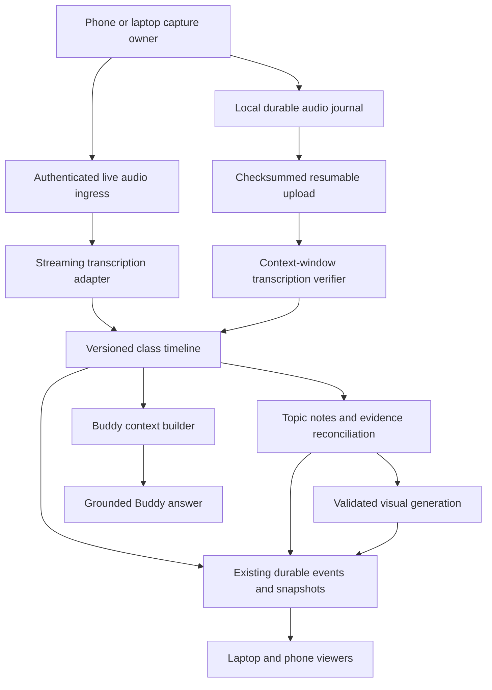

# In-Class Experience V2 — Implementation Specification

Date: 2026-10-13  
Status: Approved product direction; implementation proposal, not a statement of shipped behavior  
Audience: Coding agent implementing this repository

## 1. Objective and delivery contract

Build an In-Class experience in which a student can record a lecture from their phone, follow coherent notes on their laptop, ask their Buddy context-aware questions, and receive accurate, source-linked visual study material.

Product promise: **Listen to the professor, ask Buddy when you get stuck, and leave with notes you can trust.**

Implement the complete flows described here against the existing backend, web, desktop, and native mobile architecture. Reuse the current authentication, storage, jobs, outbox, usage accounting, material retrieval, Buddy, and visual rendering systems. Do not replace the application stack or introduce a second independent class-session system.

Before implementation, read applicable repository instructions, inspect current migrations and contracts, and record the current commit and working-tree state. This specification reflects a source inspection on the date above; resolve changed code against the behavioral requirements. Preserve unrelated work. Names marked **proposed** are contracts to implement or adapt to existing equivalent abstractions, not existing endpoints or environment settings.

Deliver working source, migrations, tests, configuration examples, operational documentation, and release evidence. Keep a checklist mapping every requirement to implementation and verification. Do not mark native behavior or provider accuracy verified solely on the basis of mocks or type checks.

## 2. Existing foundations and implementation map

Paths below are repository-relative for portability.

| Area | Existing entry points | Current evidence / implementation guidance |
| --- | --- | --- |
| Web setup and capture controls | `web/components/class-recorder.tsx` | Course/Buddy selection, consent, microphone, Windows computer audio, retention, recording controls |
| Web audio capture and recovery | `web/lib/lecture-capture.ts`, `web/lib/lecture-local-store.ts`, `web/lib/lecture-upload-queue.ts` | Small locally saved slices, upload/recovery, optional live captions; web slice timer is currently about 5 seconds |
| Class workspace | `web/components/in-class-workspace.tsx`, its CSS module | Notes, captions, references, material intake, preferences, diagnostics, study outputs |
| Class client contracts | `web/lib/in-class.ts` | Snapshot/delta merging, event stream, policy, class/reference navigation |
| Class/chat integration | `web/components/learning-workspace.tsx`, `web/components/workspace-split.tsx` | Opening a class selects its linked chat session; this does not establish complete live evidence injection |
| Backend coordination | `backend/app/in_class_service.py`, `in_class_worker.py`, `in_class_synthesis.py` | Durable output jobs, source revisions, windowing, final packages and longer-lecture synthesis |
| Backend routes/contracts | `backend/app/in_class_routes.py`, `in_class_models.py` | Owner-scoped APIs and typed outputs; notes currently contain title/body/segment IDs |
| Transcription | `backend/app/lecture_provider.py`, `lecture_pipeline.py`, `live_transcription.py` | Batch OpenAI/OpenRouter adapters and separate OpenAI live path |
| Fast note drafts | `backend/app/class_live_notes.py` | Provisional caption notes, reconciliation and retries |
| Native phone capture | `mobile/src/ClassCapture.tsx`, `recordings.ts`, `protocol.ts`, `mobile/modules/lecture-capture` | Native capture, local journals, checksummed uploads, device/epoch fields and recovery |
| Phone class viewer | `mobile/src/ClassLive.tsx` | Inspect before extending shared state and navigation |
| Desktop lifecycle | `desktop/src/class-lifecycle.cjs` | Existing tray, lock/sleep and recording lifecycle behavior |
| Provider settings | `backend/app/provider_key_routes.py`, `web/components/provider-settings.tsx` | Currently OpenAI/OpenRouter; inspect desktop credential bridge before adding providers |
| Visual infrastructure | `backend/app/openintelligentui.py`, `integrations/openintelligentui`, existing rich-content renderers | Inspect and reuse validated rendering paths where appropriate |
| Tests | `backend/tests/test_in_class.py`, `test_class_live_notes.py`, `web/tests/in-class.test.tsx`, `class-capture.test.tsx`, native protocol tests | Extend behavior coverage, retaining existing recovery guarantees |

Important findings to address:

- The OpenRouter transcription adapter accepts `previous_tail` but does not send that context; direct OpenAI sends at most a short tail. Provider capability differences must be explicit.
- Small durable audio files are also currently transcription units. Separate persistence granularity from recognition context.
- Transcript note windows target roughly 12 seconds / 1,000 characters; other output windows target about 30 seconds / 2,000 characters. These are batching rules, not end-to-end latency guarantees.
- Phone capture exists, but QR pairing and coordinated laptop/phone control require new work. Native signed/device acceptance was not established by this inspection.
- Source revision checks, partial coverage, audio recovery, saved note ownership, and final synthesis already exist. Extend these rather than bypassing them.
- Current interval practice can run at the first eligible window. Change the first interval quiz to wait for the selected interval; retain an explicit user-requested immediate quiz action.

## 3. Product requirements

### 3.1 Start class

The laptop setup offers Laptop microphone, Phone microphone, and existing supported computer-audio options. Show the selected course, Buddy, title, and a compact audio check. Advanced processing preferences remain available but do not dominate setup.

Phone flow:

1. Laptop creates a class draft and a short-lived pairing challenge.
2. Student scans a QR code or enters a pairing code in the authenticated native app.
3. Phone displays the account, class title, and requesting laptop. Student confirms pairing and recording permission.
4. Phone performs a short local input-level check and starts only after an explicit start action.
5. Both devices display the same class. Phone owns capture; laptop displays notes and Buddy.

Never assume a phone is inherently a better microphone. Explain placement and show signal quality. A basic preflight can report input present, sustained low level, or clipping; do not label it a reliable measurement of transcription accuracy.

### 3.2 During class

- Persistent capture strip: recording source, elapsed class time, capture state, connection freshness, upload backlog, and phone battery when available.
- Center: a readable evolving document organized by topic, with stable block IDs.
- Left, collapsible: topic outline and bookmarks.
- Right, collapsible: Buddy or selected reference. Preserve each panel's state when switching.
- Bottom: compact captions strip, expandable into transcript and audio evidence.
- Primary actions: Ask Buddy, I'm lost, Mark moment, Pause microphone, Stop class.
- Keep processing pause separately labeled. It must never be presented as microphone pause.
- Preserve scroll position, text selection, focused controls, and student edits while background updates arrive.
- When the student scrolls away from live content, show New notes below / Return to live; do not move them automatically.
- Use plain states such as Listening, Catching up, Saved on phone, and Reviewing transcript. Put job details in diagnostics.
- Keyboard and screen-reader access are required. Avoid announcing every caption token; announce meaningful state changes.

### 3.3 End and review

Stop requests stop capture, flush local audio, upload outstanding files, and finalize coverage. The UI can enter review while final processing continues. Do not display a finished study package until its current source revisions have passed publication checks.

Review includes coherent notes and visuals, summary, key concepts, unresolved doubts, active recall, revision quiz, and optional flashcards. Mark incomplete coverage and provide recovery. Keep audio playback only when retention policy permits it; transcript evidence must remain usable without audio.

## 4. Architecture



Keep the modular backend and existing durable queues. Use existing outbox transactions for state changes plus events. SSE remains suitable for server-to-viewer updates; bidirectional audio needs an authenticated streaming transport. Prefer backend-mediated streaming initially so provider credentials and session lifecycle remain centralized. Bound buffering and test the actual hosting proxy's long-lived connection behavior.

The phone sends audio directly to the backend, independently of the laptop. A Bluetooth virtual microphone, LAN discovery, or phone-to-laptop relay is not required for this release. Both devices need access to the same backend and authenticated owner.

## 5. Pairing, ownership, commands, and recovery

### 5.1 Pairing security and lifecycle

Proposed `class_pairings`: ID, owner ID, class ID, requesting device ID, hashed challenge, expiry, attempts, claimed device ID, state, created/claimed times. Default expiry: 120 seconds, configurable. QR payload contains only an opaque, one-use challenge and approved deep link; it is not an account login token. Human-entered codes require strict per-account/device/network rate limits and attempt limits.

Both sides authenticate as the same owner. Claim is atomic. Replayed, expired, foreign-account, or revoked challenges fail without revealing class data. Confirmation issues a scoped capture capability for this class/device/epoch. Store native credentials in secure storage and keep capabilities out of URLs, logs, and analytics.

An offline or expired connection does not authorize a second microphone. Phone permission remains mandatory. Remote resume after OS revocation, process death, or a fresh capture session requires phone confirmation. Preserve existing platform restrictions.

### 5.2 Capture identity and time

Model a class separately from capture runs. Proposed capture run: `runId`, `classId`, `recordingId`, `deviceId`, `epoch`, start/end positions on the class timeline, state, coverage and ownership history. Adapt existing recording/device/epoch structures rather than assuming sequence numbers can restart within one recording.

One run owns live capture at a time. Device handoff increments the epoch atomically. A stale device cannot append new live audio or issue commands for the new run.

Preserve recovery from old runs: previously captured, authenticated segments must be recoverable through an explicit historical-run upload path with checksum, sequence and range validation. Do not discard saved audio merely because the live lease or epoch changed. Concurrent uncertain capture becomes an overlap requiring reconciliation, never silent concatenation or deletion.

Use a monotonic sample-based clock per run and server-recorded mapping to the class timeline; do not order audio solely by device wall clock. Represent pauses, gaps, overlaps and discontinuities explicitly. Questions/bookmarks use the same class timeline. Phone and laptop elapsed-time displays derive from synchronized state.

### 5.3 Durable remote controls

Commands carry `commandId`, target run/device/epoch, expected revision, action, creation time and expiry. Persist command intent before dispatch. Repeated commands are idempotent.

Command states: `pending → delivered → acknowledged`, or `rejected / expired`. Acknowledgment records resulting capture state and device observation time. Command acceptance is not proof the microphone stopped.

- Phone local Stop always works without network and journals the result.
- Laptop Stop while disconnected displays Stop requested; phone may still be recording.
- Start/resume commands expire quickly and cannot replay after reconnect to unexpectedly open a microphone.
- Stop intent remains associated with its target run and prevents restarting that run, even if the transport delivery expires.
- Handoff normally waits for old-device stop acknowledgment. An explicit forced switch must warn that the unreachable device may still record locally and retain the overlap as a coverage issue.
- Heartbeat every approximately 5 seconds while connected; show stale after approximately 15 seconds. These are tunable UX defaults, not proof of microphone state.

## 6. Transcription quality and AssemblyAI

### 6.1 Configuration and key management

AssemblyAI is a requested new provider, not implemented in the inspected source. Implement the adapter and settings before enabling it.

Proposed local backend configuration:

```dotenv
# backend/.env only; never commit real secrets
ASSEMBLYAI_API_KEY=<server-side-secret>
AI_TUTOR_TRANSCRIPTION_PROVIDER=assemblyai
OPENLEARN_CLASS_STREAMING_PROVIDER=assemblyai
OPENLEARN_CLASS_VERIFICATION_PROVIDER=assemblyai
OPENLEARN_CLASS_STREAMING_MODEL=<verified-supported-model-id>
OPENLEARN_CLASS_VERIFICATION_MODEL=<verified-supported-model-id>
```

Retain the existing batch setting for compatibility. New class-specific settings override it only for classes; do not change unrelated voice or general lecture behavior accidentally. Preserve existing defaults until explicitly configured. Separate speech provider choice from the text-generation provider.

Extend backend settings and the desktop OS credential-store bridge with AssemblyAI presence, validation and removal. Hosted secrets must use the deployment's server secret store; do not expose the local-development server-wide key-write endpoint to arbitrary hosted tenants. Document operator-managed versus per-user credentials and preserve current authorization boundaries.

Verify current AssemblyAI API/model documentation during implementation. Do not hardcode example model IDs from this document or assume every model supports the same languages, vocabulary hints, confidence or diarization. Surface capability validation errors before starting a paid stream when possible.

Reference documentation:

- https://www.assemblyai.com/docs/getting-started/models
- https://www.assemblyai.com/docs/streaming/label-speakers-and-separate-channels
- https://www.assemblyai.com/docs/meeting-notetaker-best-practices

### 6.2 Adapter contract

Extend the existing provider abstraction through versioned compatible contracts. Separate streaming start/feed/close/reconnect from asynchronous prerecorded submit/status/result operations. Do not block a database transaction while waiting on provider network work.

Normalize outputs to: provider/model/request ID, run ID, source audio range, transcript segment ID and revision, text, optional timed words, speaker ID, optional confidence, language, source kind, and settlement state. Missing confidence is null, never synthesized. Provider confidence scales require calibration before sharing thresholds.

Preserve raw provider output in access-controlled storage where retention permits; publish normalized schema-validated data. Persist external request IDs to recover asynchronous submissions after worker restart. Where providers lack idempotency, reconcile ambiguous submissions before resubmitting and record potential duplicate billing.

### 6.3 Recognition pipeline

Keep small durable local slices for loss recovery. Build continuous streaming frames and longer verification windows independently from those files; decode/remux correctly rather than concatenating container bytes. Verify format, channels, sample rate and time mapping. Resample once where necessary.

Initial configurable verification experiment: 30–60 second windows with 2–5 seconds of context overlap, closing earlier on suitable pauses. Merge on source time and alignment, not broad text deduplication: legitimate repeated phrases must survive. These are starting parameters to benchmark, not guaranteed optimal values.

Build a bounded glossary from explicitly available course materials: names, terms, abbreviations and formula vocabulary. Version it and attach it to each transcription request. Treat documents as data, never instructions. Do not substitute glossary words into unclear speech without acoustic support.

Streaming turns produce fast provisional evidence. Recorded audio verification produces settled evidence for its covered range. Preserve replacement mappings even when one streaming segment becomes several verified segments or vice versa. A provider failure must not promote unverified captions into settled truth.

Add speaker labels where supported. The student can identify the professor; do not assume the first or loudest speaker is the professor. Avoid treating overlapping speech as reliably separated.

Unclear spans remain visible and can be replayed or corrected. Human corrections have precedence over subsequent automatic passes, retain provenance, and trigger targeted artifact invalidation. Support undo through a new revision.

### 6.4 Reliability, cost and evaluation

- Bounded reconnect backoff, explicit provider session IDs and overlap tracking; reconnect must not duplicate transcript or notes.
- Live streaming failure leaves local recording operational. Offline recovery uses batch verification; do not replay hours of old audio as if it were live.
- Meter streaming and verification separately through existing usage admission/settlement. Reserve/settle by bounded intervals, not an unlimited session reservation.
- Offer a documented streaming-plus-verification quality mode and an economical mode with verification limited to uncertain intervals/end-of-class passes. The UI accurately describes which evidence remains provisional.
- Bound provider concurrency, uploaded window size, class duration work, retries and storage. Cap uncommitted audio buffering and resume from durable audio on overflow.
- Build a consented, versioned evaluation corpus with accents, noisy rooms, technical terms, pauses, equations, student questions, and mixed languages relevant to users.
- Manually verify reference transcripts. Compare WER, technical-term errors, omissions, repetition, numeric/equation mistakes, speaker attribution, latency and cost per recorded hour on the same samples.
- Release candidate must improve measured terminology and overall recognition versus the current provider on the held-out corpus without a material regression on a declared subgroup. Publish results and known limitations; do not declare success from vendor claims alone.

## 7. Shared evidence model and synchronization

Use the existing class event cursor/revision mechanism. The following are proposed logical records; combine them with existing tables when that preserves clear ownership and queryability.

| Record | Required information |
| --- | --- |
| Capture run | Device, epoch, recording linkage, class-time mapping, state, coverage, acknowledgments |
| Transcript revision | Stable segment identity, source run/audio interval, text, timed words if available, provider, speaker, revision, provisional/verified/human-corrected state |
| Evidence replacement | Old segment/revision → replacement segment/revisions and time coverage |
| Topic section | Stable ID, class range, heading, summary, evidence refs, revision and draft/settled status |
| Note block | Section/order, typed content, generated evidence manifest, generated revision, student-edit ownership |
| Class question | Message linkage, submission timestamp, class anchor, selected evidence, context manifest and resolution state |
| Visual artifact | Validated specification, source manifest, revision, generation status, alt text, content hash |

An evidence reference contains at least `segmentId`, `revision`, `runId`, `startMs`, `endMs`, and source kind. Supplemental material references include material version and span/page identifiers. Every generated artifact stores an input manifest and generator/schema version.

Class event envelope example:

```json
{
  "id": "opaque-event-id",
  "classId": "class-id",
  "cursor": 123,
  "type": "transcript.revised",
  "aggregateId": "segment-id",
  "revision": 3,
  "occurredAt": "server-time",
  "data": {"replacementRefs": [], "coverage": {"startMs": 1000, "endMs": 8000}}
}
```

Follow existing timestamp serialization where different. Events include capture status/command acknowledgment, transcript commit/revision, section/block patch, artifact invalidation, visual readiness, doubt updates and finalization progress. Owner checks apply to every snapshot, event subscription, audio request, reference lookup and command.

Clients merge only non-stale revisions, deduplicate events and recover from cursor loss via authoritative snapshots. Paginate transcript and outputs; keep browser and worker memory bounded on a multi-hour class. A changed transcript invalidates only dependent artifacts. Publish regeneration only if its source manifest is still current. Show Updating when an artifact becomes stale; never silently present it as verified.

## 8. Buddy during class

Extend the existing chat/Buddy flow with a typed class context attachment rather than creating a disconnected chat system.

On submission, persist `classId`, `anchorMs`, selected note/segment/reference IDs with revisions, and the latest available transcript watermark. Freeze this question context; reconnect, retry, or later lecture progress must not move the question to a different moment.

Context builder, with explicit token budgets:

1. Selected passage/equation, if provided.
2. Approximately the last 2–3 minutes before the anchor, bounded by tokens and available coverage.
3. Current topic and rolling outline through the anchor.
4. Relevant earlier lecture passages retrieved within this class.
5. Relevant authorized course material.
6. Appropriate existing Buddy/learner context and relevant prior doubts.

Retrieval must enforce owner, class/course, time and material-version boundaries. Live answers default to evidence at or before the question anchor. Review questions may explicitly request the whole completed class. If the latest speech is still processing, indicate the available-through time rather than pretending to have heard it.

Answer contract includes body, cited evidence, supplemental explanation labels, uncertainty, context manifest, and optional suggested next action. Resolve citation IDs server-side and reject nonexistent or unauthorized references. Transcript and document content are untrusted data.

Shortcuts: Explain what they just said; I missed the last minute; Why does this step follow?; Explain selected content; Save this doubt. I'm lost stores a timestamped doubt immediately and opens Buddy with a concise request. It never pauses the lecture microphone automatically.

Student can mark a doubt resolved, reopen it, add it to review, or request a deeper explanation. Buddy stays text-first and quiet in class; spoken output requires an explicit action. Persisted answers retain the evidence revision used at the time. If later corrections affect an answer, mark it for review and offer regeneration rather than silently rewriting chat history.

## 9. Coherent notes and visual blocks

### 9.1 Notes document

Separate fast transcript-driven note drafts from topic organization. A topic organizer periodically merges related generated blocks and updates the outline with stable IDs. Trigger on sufficient new context, topic transition or explicit request; avoid an expensive full-class rewrite on every audio slice.

Use granular insert/update/move patches and optimistic concurrency. Student edits are separate from generated source revisions. Once a student edits a block, regeneration becomes a suggested change requiring acceptance; untouched generated blocks can update automatically. Never overwrite student text, quiz attempts, bookmarks or annotations.

### 9.2 Typed content

Proposed discriminated union: `paragraph`, `bullets`, `equation_steps`, `comparison_table`, `flowchart`, `concept_map`, `plot`, `illustration`. Each block has ID, schema version, evidence manifest, settlement status and accessibility description as appropriate. Preserve rendering of legacy title/body blocks.

For diagrams store validated nodes/edges, labels and layout hints. For plots store bounded series or a validated mathematical specification with axes, domains and units. Never execute arbitrary generated JavaScript/Python or embed unsanitized HTML/SVG. Reuse existing safe renderers and sandbox boundaries. Validate node/edge limits, expression complexity, numerical ranges and render timeouts.

A visual distinguishes lecture-derived facts, supplemental explanation and illustrative data. Unsupported numeric values cannot appear as measured lecture data. Exact derivations should be checked with available deterministic math tooling where practical; ambiguous spoken notation requires confirmation.

Auto-suggest visuals when a topic has enough evidence and a visual improves understanding. Generate at most one automatic candidate per topic initially, with configurable budget and deduplication. Provide Visualize this, Edit, Regenerate, Show evidence, and Remove. Illustration/image generation is a later typed renderer but remains part of this scope where spatial concepts warrant it; exact labels should be inspectable overlays and source-supported.

Source corrections invalidate dependent visuals. Keep the previous version visible with an Updating label until a valid replacement is ready. Failed generation leaves usable text notes and a retry action.

## 10. Proposed API surface

Prefer extending existing routers. Final names may follow existing conventions, but preserve these semantics and document them in OpenAPI. All mutations require authentication, appropriate ownership/capability, idempotency, and revision checks where relevant.

| Method / proposed path | Behavior |
| --- | --- |
| `POST /v1/class-sessions/drafts` | Create setup before audio exists; retries return the same draft |
| `POST /v1/class-sessions/{id}/pairings` | Issue expiring QR/code challenge |
| `POST /v1/class-pairings/claim` | Authenticate and atomically claim challenge; confirmation scoped to device |
| `DELETE /v1/class-sessions/{id}/pairings/{pairingId}` | Revoke pending pairing |
| `POST /v1/class-sessions/{id}/capture-runs` | Acquire recording ownership after consent |
| `POST /v1/class-sessions/{id}/capture-runs/{runId}/heartbeat` | Report capture state, acknowledgments and optional battery/backlog |
| `POST /v1/class-sessions/{id}/capture-commands` | Persist remote pause/stop/resume/handoff intent |
| `POST /v1/class-sessions/{id}/capture-commands/{commandId}/ack` | Owning device records execution or rejection |
| `POST /v1/class-sessions/{id}/transcription-sessions` | Negotiate authenticated live transport and bounded provider session |
| `PATCH /v1/class-sessions/{id}/transcript/{segmentId}` | Persist human correction with expected revision and source provenance |
| Existing chat submission + `classContext` | Ask Buddy with frozen anchor and selection |
| `POST/PATCH /v1/class-sessions/{id}/doubts[/... ]` | Persist bookmark/doubt and resolution lifecycle; choose conventional concrete routes |
| `GET/PATCH /v1/class-sessions/{id}/document[/... ]` | Paginated document and per-block edits with conflicts surfaced |
| `POST /v1/class-sessions/{id}/visuals` | Enqueue bounded visual generation from authorized evidence |
| Existing snapshot/stream/output APIs | Add versioned data/events and preserve old clients |

Draft creation must bridge the existing recording-first creation model. Do not let phone claim create a second class. Expire abandoned empty drafts without deleting any captured audio. Reuse existing upload/finalize routes with run identity or add a compatible run-scoped extension. Define machine-readable conflict, expired-pairing, stale-epoch, missing-audio, quota, unsupported-model and unavailable-provider errors.

## 11. Scheduling, observability and latency

Separate bounded work lanes: audio ingest/stream handling; transcription and reconciliation; interactive Buddy/notes; background visuals, indexing and final synthesis. Reserve capacity for interactive work, but ensure verification and finalization cannot starve. Use per-owner quotas and fairness rather than letting one long class occupy the worker pool.

Measure capture-to-caption, capture-to-verified-transcript, transcript-to-note, Buddy time-to-first-token, correction propagation, backlog duration, reconnect count, lost/duplicate ranges, provider usage and cost. Trace by class/run/window/job IDs without logging secrets or full private transcript bodies by default.

Initial engineering targets under a documented healthy-network/reference-device/load profile: p95 final streaming turn visible within 3 seconds of its acoustic endpoint; p95 note update within 10 seconds of a committed input window; p95 Buddy first token within 3 seconds after context is ready; connected command acknowledgment within 2 seconds. Measure verification lag separately because window closure adds latency. These are targets to validate and tune, not promises to users or excuses to skip accuracy checks.

## 12. Migration and rollout

Use additive migrations and versioned payloads. Existing classes and recording recovery must remain readable. Backfill new records lazily or in bounded batches; do not synthesize nonexistent confidence, speaker identity or word timing.

Introduce independent rollout flags for phone pairing, AssemblyAI, context-window verification, class-aware Buddy, topic notes and visual notes. Default new behavior off until its phase passes acceptance. Flags must allow observation/rollback without abandoning active recordings. Persist chosen provider/model and run semantics per active session; changing global settings does not abruptly switch an in-flight stream.

Use dual readers during transition, with one authoritative writer per artifact. Avoid shadow provider calls without usage limits and disclosure. Document rollback compatibility and irreversible data transformations; prefer disabling new generation while preserving read support for new artifacts.

Retention applies across raw audio, assembled verification windows, provider uploads, transcript revisions, visuals and local phone files. Preserve audio needed for incomplete recovery according to existing user policy, then clean temporary copies. Account deletion and sign-out paths must include new sessions, capabilities, requests and caches. Native logout stops local capture before clearing account access.

## 13. Implementation phases and exit criteria

### Phase 0 — Baseline and contract inventory

Inspect current capture authorization, mobile run protocol, Buddy prompt assembly, rich-content rendering, quotas and hosting streaming support. Record baseline tests and recognition benchmarks. Produce final schema/API changes and a traceable requirement checklist. No provider secrets are required in committed fixtures.

Exit: reproducible baseline; migration and compatibility plan; evaluation corpus definition and available real samples documented.

### Phase 1 — Evidence and transcription quality

Implement AssemblyAI settings/adapters, normalized capabilities, continuous live ingress, verification windows, glossary, timings, corrections, revision reconciliation, metrics and usage accounting. Preserve fallback capture and existing providers. Add a minimal readable uncertainty/correction UI.

Exit: actual configured provider completes a recorded fixture and a live test; no duplicate boundary text or missing coverage on reconnect; correction updates dependent generated notes; published benchmark comparison and actual usage accounting. If credentials or real fixtures are unavailable, report that specific acceptance gap.

### Phase 2 — Phone pairing and ownership

Implement draft bridging, QR/deep-link claim, native confirmation, run mapping, remote commands, status strip, reconnect, historical uploads and handoff. Test iOS and Android native builds, not only a mobile browser.

Exit: laptop starts setup, phone records, laptop receives notes; laptop closure does not stop phone capture; offline audio recovers; stale commands cannot restart capture; lost acknowledgment is represented honestly; cross-account/replay attempts fail.

### Phase 3 — Class-aware Buddy and doubts

Implement frozen anchors, bounded context building/retrieval, grounded citations, lag/uncertainty handling, quiet panel, selection actions, I'm lost, and reviewable doubts.

Exit: questions about recent or selected material cite the correct moment; later lecture content cannot shift an earlier question's context; missing/unclear evidence produces an honest response; doubts persist across devices.

### Phase 4 — Calm workspace and coherent notes

Implement the responsive panel layout, topic outline, stable document patches, protected edits, caption strip, evidence playback and review screen. Keep processing preferences secondary. Correct interval practice first-fire behavior.

Exit: long-session updates preserve reading position and selections; student edits survive regeneration; all primary actions are keyboard-accessible; finalization and partial recovery remain usable.

### Phase 5 — Visual notes

Implement typed schema, validated renderers, explicit and selective automatic generation, evidence/uncertainty labels, editing, export integration where the existing note export supports it, and correction invalidation. Include diagram, equation, table, plot and illustration paths with appropriate validation.

Exit: representative course examples produce useful visuals with traceable evidence; malformed specifications fail safely; stale visuals are labeled; generation failures preserve text notes; exported notes retain usable visual content or an explicit supported fallback.

### Phase 6 — Integrated acceptance and rollout

Run the full phone-to-laptop lecture scenario with concurrent questions, reference lookup, transcript correction, visuals, offline recovery and final package. Evaluate multi-hour memory/query bounds and concurrent-class fairness. Publish device matrix, measured latency, recognition quality, costs and known limitations. Enable incrementally with rollback instructions.

## 14. Required verification matrix

| Scenario | Expected result |
| --- | --- |
| Pairing code expires/is reused/belongs to another account | No unauthorized claim or data disclosure |
| Phone microphone permission denied/revoked | Clear failure; no false Recording state; saved audio retained |
| Phone screen locks, call interrupts, OS kills app | Supported capture behavior measured; gaps journaled; restart never silently records |
| Laptop disconnects or closes | Phone local capture and direct upload continue where network/OS permit |
| Phone loses network for several minutes | Durable local audio survives; bounded backlog; no fake live transcript |
| Stop sent while phone is offline | Stop requested remains distinct from acknowledged stop |
| Duplicate/out-of-order uploads and command retries | No duplicated audio, outputs, or side effects |
| Device switch with pending old audio | One live owner; historical audio recoverable; overlaps explicit |
| Provider stream/session expires or worker restarts | Bounded recovery; durable request tracking; no unbounded duplicate billing |
| Numeric/technical term is unclear | Uncertainty preserved; user can replay/correct; no invented evidence |
| Transcript splits/merges on verification | Evidence maps and affected artifacts reconcile correctly |
| Student edits note before transcript correction | Student text preserved; suggested replacement available |
| Buddy asks at 10:00 while lecture reaches 10:30 | Context stays anchored to 10:00; citations remain resolvable |
| Prompt injection in transcript/course PDF | Treated as evidence text; no tool or instruction privilege |
| Visual contains invalid code/unsafe markup/huge graph | Validation rejects; safe retry; notes remain usable |
| Retention disabled | Temporary/server audio cleaned after permitted processing; transcript citations still work |
| Multi-hour class and concurrent classes | Bounded memory/pages/queues; interactive work remains responsive |
| Finalization with missing audio, then later recovery | Partial package labeled; current artifacts rebuilt without erasing student work |
| Old client opens old/new class | Compatible fields or explicit version requirement; no corrupt writes |

Use provider mocks for deterministic error/contract tests plus explicit real-provider acceptance. Use existing pytest, Vitest, native protocol and desktop lifecycle suites. Read current package scripts before choosing commands; the repository does not necessarily expose a generic `npm test` for every package. Native microphone/background guarantees require actual device evidence.

## 15. Definition of done and agent handoff

Complete only when each phase's shipped behavior has evidence, or its remaining external blocker is explicitly recorded. The final implementation report must contain:

1. Changed components and architecture decisions, including any justified deviations from proposed names/defaults.
2. Migrations, backward compatibility, flags and rollback steps.
3. Exact AssemblyAI setup instructions for local backend, desktop and hosted environments, without secrets.
4. Automated test results and real-provider/native acceptance results, clearly separated.
5. Recognition comparison, latency measurements and cost methodology.
6. Known gaps with concrete reproduction steps and owner/action required.

Prioritize accuracy, capture durability, honest state and preserved student work throughout. A polished screen without the corresponding capture, evidence, recovery and Buddy contracts does not satisfy this specification.
